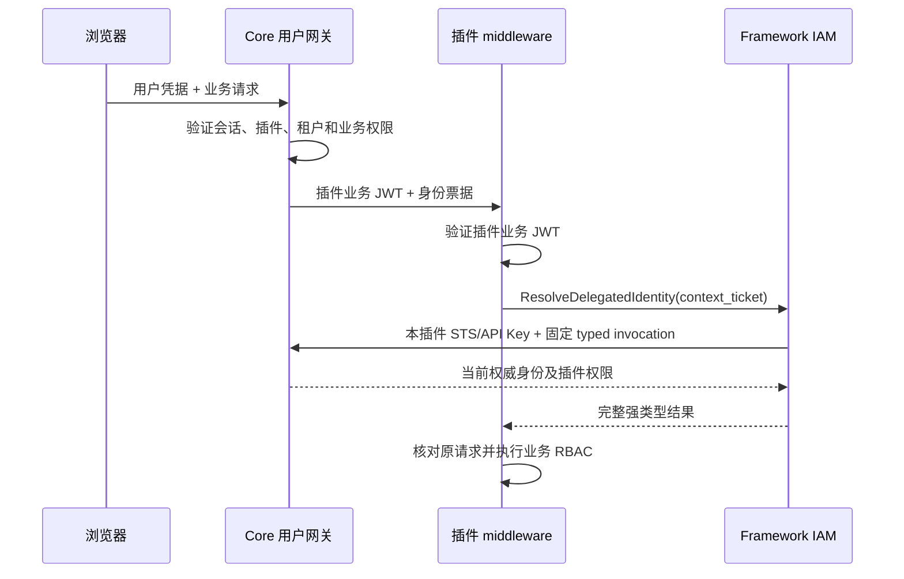

# Framework 插件请求身份接入

更新：2026-10-11。依据 [Core 正式合同](../../../../PowerX/docs/contracts/plugin-request-identity.md) 、[WS 实时复核合同](../../../../PowerX/docs/contracts/plugin-ws-revalidation.md) 和 [OpenAPI](../../../../PowerX/specs/018-plugin-request-identity/contracts/identity-context.openapi.yaml)。

## 1. 当前交付范围

Go/.NET 已实现强类型票据解析、严格身份结果校验、middleware 和 WS 生命周期。Skeleton、scaffold、CLI 内嵌模板已同步。前端桥接 v2 保持宿主用户会话管理，同时识别正式的用户、服务凭据和票据错误码。

开发期继续使用本地 Go `replace`、Nuxt `file:` 和 .NET ProjectReference。没有修改发布版本、打 Tag 或发布包。真实安装及 Core/消费插件浏览器联调仍需另行验收。

## 2. 调用链与接口



票据来自 Core 注入的 `X-PowerX-Identity-Context`。浏览器不生成、持有或转发它。新的查询输入只有 `ContextTicket`；Framework 自动固定 schema、capability、operation 与 `core_internal`，不接受自由 endpoint/method/header 或身份覆盖字段。

Go：

```go
client, err := delegated.NewCoreClient(delegated.CoreClientConfig{
    BaseURL: hostBaseURL,
    PluginID: pluginID,
    Tokens: serverSTSTokenProvider,
})
// API Key 使用 NewCoreClientWithAPIKey(config, serverOwnedKey)。
identity, err := client.ResolveDelegatedIdentity(ctx, contracts.DelegatedIdentityQuery{
    ContextTicket: coreInjectedTicket,
})
```

.NET：`PowerXIamClientOptions.PluginId` 配置当前插件；`Credentials` 接受后端 `IServiceCredentialProvider`。显式静态服务凭据可通过 `Credential` 与 `AuthScheme` 配置。`IDelegatedIdentityService.ResolveDelegatedIdentity(DelegatedIdentityQuery, CancellationToken)` 使用同一固定 typed invocation。

两个客户端均使用 `POST /api/v1/tenant/invocations`，读取正式 `data.result.result` 结果。票据传输不记录正文；Go 禁止自动跟随重定向，.NET 默认 HTTP handler 禁止重定向，注入自定义 HttpClient 时调用方也须关闭自动重定向。错误不保留可能回显票据的上游正文或 message。查询的格式化输出也会脱敏。

旧 delegated `ResolveIdentity(ctx, pluginBearer)`／`.ResolveIdentity(bearer)` 返回 `409 / IAM_IDENTITY_MIGRATION_REQUIRED`，不会调用用户 `/me/context`。Local provider 保留自己的身份处理；不得以 Local 或 claims 解析补足 delegated 证明。

## 3. 响应及校验

Go `contracts.DelegatedIdentity`、.NET `Models.DelegatedIdentity` 映射：

| 字段 | 规则 |
|---|---|
| schema / mode / plugin_id | 必须是正式 schema、delegated 和当前插件 |
| tenant_uuid / user_uuid | 有效、非零、标准 UUID，不能使用 numeric ID 或默认租户 |
| member_uuid / is_root | 普通成员必须有 UUID；权威 Root 允许明确 null，不接受省略字段 |
| roles / permissions | 映射当前插件范围数组；角色名不推导 Root |
| policy_version / perms_hash | 必须存在，完整保留 |
| source_method / source_path / source_required_permission / transport | 原请求关联，区分 http、ws_grant、ws_upgrade |
| source_request_id / source_trace_id / trace_id | 同时保留原请求及本次解析诊断标识 |
| proof_expires_at / user_session_expires_at | 分别保留，不能互换或通过解析续期 |

省略必需字段、无效 UUID、空权限数组以外的非法权限形态、错误 schema/插件、旧 `expires_at` 格式及票据有效期超过用户会话均明确拒绝。Go 使用纳秒时间；.NET 保留原始 RFC3339Nano 字符串，计算有效期时向下截断到其时间精度，避免延长用户期限。

## 4. Middleware 与消费者迁移

Go 的通用入口是 `iam/middleware.RefreshDelegatedIdentity`，HTTP 与 WS 可共用 `ResolveRequestIdentity`。业务检查使用 `RequireIdentityPermission`，或消费标准 context 中的 `iamcontext.DelegatedIdentityFromContext`。

Skeleton 的顺序：

1. JWTAuth 验证 Core 插件业务 JWT；delegated 不使用旧签名上下文认证入口。
2. RefreshFrameworkIAMContext 解析票据并核对插件、已验证的租户/用户、method/path、transport，以及传入的原 request/Trace。
3. 将 Core 结果写入租户与身份 context。`AuthzSource=core_identity_ticket`，包含 UserUUID、Root、当前权限和版本。Root 也经过解析。
4. RBAC 使用该票据携带的 Core 正式业务 permission code 检查原请求，避免旧技术路由别名与业务代码错配。不得通过 `super_admin` 等角色名跳过 delegated 业务检查。

`.NET UseDelegatedIdentity(options)` 在已验证入站认证之后、`UseAuthGuard` 之前注册；TenantAssertion/UserAssertion 只能读取已验证上下文。委托模式的 AuthGuard 必须有权威身份。旧的 TenantContext middleware 不应在新身份提交之后再通过 query/header 覆盖租户。

Skeleton 启动绑定强类型解析器并验证 delegated registry；缺解析器、插件标识或服务凭据明确失败。AI Craft 等外部插件还需迁移已经复制的 bootstrap、middleware、Root 旁路和 WS 调用处，随后重新构建。单独升级依赖不会替换已复制代码。

## 5. 错误与前端会话

客户端保留原 HTTP、machine code、reason code、当前/来源 Trace 和上游 request ID。用户可见文案走 locale；不分析自由文本来猜测登录过期。

| 失败 | 行为 |
|---|---|
| IAM_CONTEXT_USER_SESSION_EXPIRED | 由宿主确认当前用户新快照后，业务请求最多重试一次；再次失败清插件自己的消费会话 |
| IAM_CONTEXT_USER_SESSION_INVALID | 清当前插件消费身份、业务缓存及连接，提示回宿主同步/登录；不自续期或使用旧格式 |
| IAM_CONTEXT_SERVICE_CREDENTIAL_INVALID / EXPIRED | 后端服务凭据问题，不能清浏览器用户会话 |
| IAM_CONTEXT_PROOF_REQUIRED / INVALID / EXPIRED | 明确证明错误；需要重新发起经 Core 认证的原请求，不能复用过期票据 |
| IAM_CONTEXT_WS_HANDLE_REQUIRED / INVALID / EXPIRED | 拒绝业务消息并关闭连接；重新走 Core 认证的握手，不使用过期 handle，也不触发浏览器 Token 刷新 |
| 403 / registry.* / CAPABILITY_* | 保留实际服务或业务授权拒绝，不刷新用户 Token 绕过权限 |
| IAM_CONTEXT_POLICY_CHANGED | 丢弃旧身份结果，重新走原请求及实时授权 |
| IAM_CONTEXT_UNAVAILABLE | 明确依赖不可用，保留 Trace，不返回空身份或匿名成功 |

嵌入模式不注销宿主、不删除宿主存储。旧会话的迟到错误不能清除新会话。Standalone 的本地用户令牌错误仍按其原登录合同处理。

## 6. WS topic 与生命周期

Go `realtime.IdentityLifecycle` / .NET `WSBus.IdentityLifecycle` 提供：

- 显式 TTL，上限为 `user_session_expires_at` 与固定的 `ws_revalidation_expires_at`；原请求票据的 60 秒期限不作为 WS 连接续期依据。
- 每次业务入站、订阅和业务下行发送前调用 Core `revalidate_ws_identity`，随后用返回的当前权限检查 topic；不缓存成功结果供后续消息授权，未授权 topic 不进入成功 ACK。
- 无消息流量时也按期限关闭连接。
- `Revoke(IdentityRevocation)` 按插件、租户、用户、成员或权限版本选择连接，撤销后不再授权消息。
- 在身份解析前读取 Revision，注册连接时核对，拒绝解析期间发生撤销的旧结果。

Skeleton：standalone 使用 `/api/ws`；Core `/_p/<plugin_id>/api/ws` 转发至插件 `/api/v1/ws`。Delegated upgrade 验证 Core 业务 JWT，再解析 `transport=ws_upgrade` 票据，检查 descriptor 的协议、动作及租户/成员范围。descriptor 可配置 `permission` 进一步检查 Core 当前业务权限。当前 Skeleton 对 delegated 连接设置一分钟期限，并受原用户到期时间上限约束。

`/admin/runtime/ws-bus/grant` 同样检查订阅 topic，并返回受用户会话约束的 expires_at。它是现有 topic grant 调试接口，未新增浏览器票据或新的 WS Token 协议。消费插件若签发自己的 WS 专用 credential，必须使用 BoundIdentityExpiry/BoundExpiry 限制期限，并绑定明确的授权 topic。

### 已接入 Core 消息触发的实时复核

Core 已发布 `powerx.iam.plugin-ws-identity-query/v1` / `powerx.iam.plugin-ws-identity/v1`。Go `contracts.WSIdentityRevalidationService.RevalidateWSIdentity` 和 .NET `IWSIdentityRevalidationService.RevalidateWSIdentity` 都使用既有 `com.corex.iam.identity_context.service_read`、固定 `core_internal` binding 和 operation `revalidate_ws_identity`。不需要扩大到 Admin manage；开发 Key / STS 的实际 grant 状态须按 Core 合同验证。

grant/upgrade 票据解析得到的 `ws_revalidation_handle` 及固定期限只留在服务端连接状态。它与原请求 ticket、浏览器 WS credential 是不同对象；查询及响应的默认 JSON/字符串格式化不暴露 handle，客户端的内部网络请求才显式向 Core 传输它。

Go `IdentityLeaseOptions.Revalidator` / .NET `IdentityLifecycle.Open(..., revalidator)` 必须绑定强类型服务。Go 的 `lease.Revalidate(ctx)`、`lease.AuthorizeTopic(ctx, topic)` 和 .NET 的 `RevalidateAsync`、`AuthorizeTopicAsync` 在处理业务前复核，并检查原插件/租户/用户/成员、原请求、原 access 和 handle 到期时间的绑定。当前权限与 policy version 可变化；topic 检查消费当前返回权限，不使用握手时的权限。

消费插件的消息处理顺序：

1. 握手时解析 `ws_upgrade` 票据，以服务端 handle 和强类型 revalidator 注册 lease。
2. 每条业务入站调用 `Revalidate`；涉及 topic 的订阅、业务处理和下行调用 `AuthorizeTopic`，.NET 必须等待对应异步方法完成。
3. 复核成功后才处理消息、提交订阅 ACK 或投递事件；取消、到期或断连后丢弃仍在排队的消息。
4. Close 回调取消连接上下文并关闭 socket，同时释放订阅；不能只更新 UI 状态。

401、403、409、503、身份来源错配及无效结果均拒绝本条消息并关闭连接。SDK 保留实际 HTTP、machine code、request ID 和当前/来源 Trace；不自动重新授权、续用户会话或使用旧权限。迟到结果不能恢复已撤销的 lease。

空闲连接按固定到期时间关闭；不通过 ping/pong 或定时任务轮询 Core 身份。此 v1 不承诺空闲连接在退出瞬间收到推送；下一条业务消息必须复核通过后才能执行/投递。`Revoke` 继续用于调用方已知的可信本地撤销事件，不假装已接入尚未发布的 Core 事件 topic。

AI Craft 当前 backend 的本地 `replace` 已指向这份 Framework；其连接初始化、入站、订阅和 event 下行调用点已接入 revalidator。消费插件仍须自行重新编译、验证实际运行进程及制品；本仓库不替它重启用户进程。

## 7. 能力、路由及联调门槛

- Skeleton required capabilities 增加 `com.corex.iam.identity_context.service_read`。
- API Key 必须有正式 scope/action/resource grant 和目标插件 owner；STS 必须有该能力和正确插件身份。
- 新 `/ws` route 声明业务权限 `runtime.realtime:read`，默认授权 owner/admin；其他成员角色需明确配置，不能靠 topic 认证规避路由授权。
- Core 新会话关联要求宿主正常续期/重新登录获取新 access；旧格式不做推断。
- 安装插件时需同步 manifest 和授权；若能力版本锁需升级，按 Core 正式版本确认流程处理。

验证记录见 [身份解析历史验收记录](evidence/plugin-request-identity-framework-20261011.json) 和 [本轮 WS 实时复核记录](evidence/plugin-ws-revalidation-framework-20261011.json)。已覆盖 SDK HTTP 合同、Root/null 成员、权限、缺票据、来源错配、错误保真、前端会话隔离、WS 到期/撤销与真实 101 握手。101 测试使用本地临时服务及 Core 合同 fixture，不能替代真实安装、浏览器及 Core 退出/停用/撤权验收。测试监听器由测试清理；没有启动或重启用户日常服务。

当前通过：Go Framework 全模块测试、身份及 WS race 检查、Skeleton 相关测试及后端编译、.NET 196 项测试、前端 186 项测试、严格类型检查、模板同步与 CLI 生成测试。身份解析阶段的 Nuxt 生产构建已通过，本轮 WS 后端与错误分类修改未重复生产构建。

本轮通过真实 SDK 和现有开发 API Key 调用了重启后的 Core 8077 `revalidate_ws_identity`。未签发的有效格式 handle 正确返回 `IAM_CONTEXT_WS_HANDLE_EXPIRED`，但运行进程的 typed 网关返回 HTTP 502，合同要求 401；Trace 为 `9b62e1d2-398a-423b-9800-6a037c301c12`。该真实负向验收仍失败，已向 PowerX 提出业务错误状态透传要求。Framework 保留实际状态，不通过客户端重映射掩盖差异。真实合法 handle、STS 及安装后的退出/停用/撤权断连仍待联合验收。

后续 SDK 复测在链接阶段被本机磁盘不足阻挡（`no space left on device`）；随后独立 HTTP 探测 8077 返回连接拒绝，没有取得新响应。上述 502 是此前成功连接时的实测，不能据此判断尚未加载或未运行的新 Core 代码。没有清理用户文件、停止用户服务或重新启动 Core。

清单基本同步校验通过。`ci-manifest-align` 的完整检查被现有 `_topic.knowledge.ingestion.progress` 执行映射与 publish ACL 缺失阻挡；未修改这项 Knowledge 配置。完整检查仍不能标记通过。


## 2026-10-11：WS 实时复核交付复验

补齐 Go / .NET 的 WS 错误平面与 handle 防泄露回归，并使 .NET 空身份结果明确返回 `IAM_CONTEXT_RESPONSE_INVALID` 后断连。Go Framework、Skeleton 的相关 race 检查，.NET 身份/WS 定向测试，以及 AI Craft bootstrap/WS 定向测试已执行。新证据记录在 [WS Framework 复验](evidence/plugin-ws-sdk-recheck-20261011.json)。此前验收记录中的“等待 Core 实时复核合同”属于交付前历史；本轮仍不宣称真实 Core 撤销、安装后浏览器或发布版本已验收。
