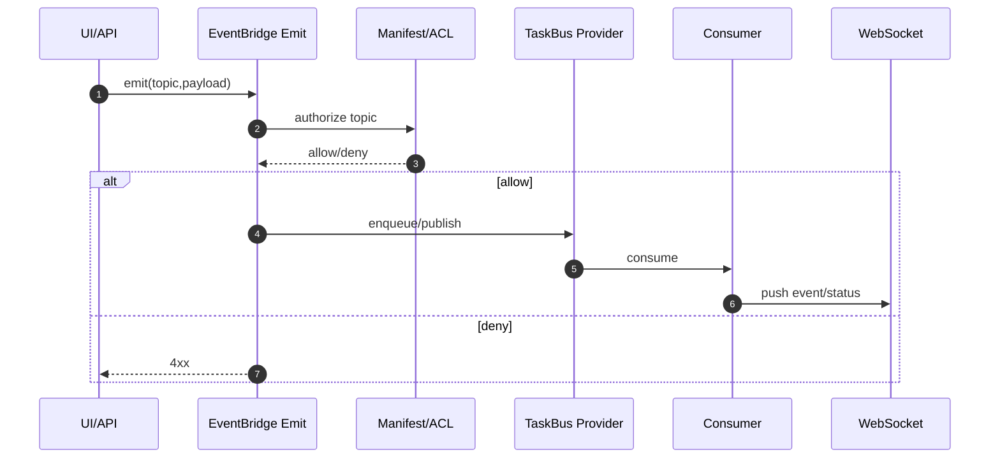

# Task 机制说明（插件侧）

## 1. 核心模型

1. `topic`：事件语义（发生了什么）
2. `subscriber`：消费逻辑（谁处理）
3. 执行承载由统一 `RuntimeMode` 派生（`redis` / `host`），不再提供独立 YAML 选择

## 2. 生命周期（插件实现）

## 3. 执行边界

1. WebSocket 只负责实时分发，不承担任务执行
2. 任务执行不由页面轮询触发
3. proxy 场景租户由底座按凭证解析，插件侧不注入 tenant

## 4. 模式映射

1. 本地：`POWERX_PROVIDER_MODE=local`，proxy 为 `0` 或 `1` 均选择 Redis TaskBus
2. 委派：`POWERX_PROVIDER_MODE=delegated`，proxy 为 `0` 或 `1` 均选择 Host Event Fabric
3. Host：由 framework 统一封装，业务层无感知
