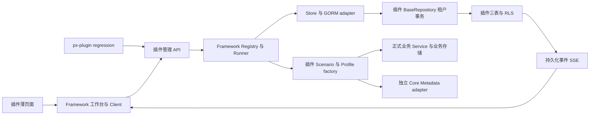
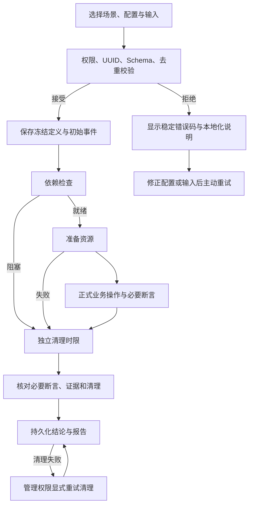
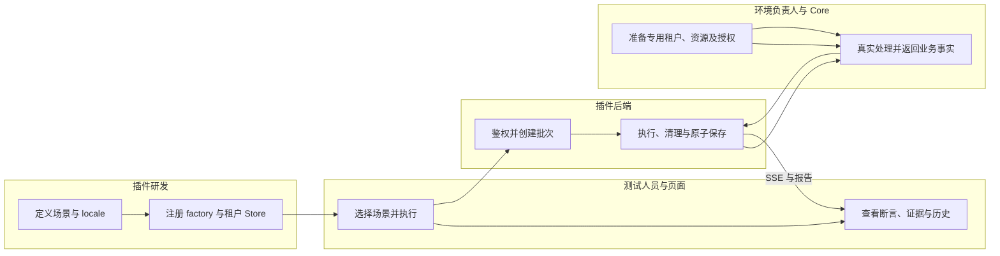

# 插件业务回归接入与使用指南

## 1. 功能背景与目标

插件开发者在管理端选择业务场景，执行正式业务 Service，查看结构化断言、业务读回、清理和历史。Framework 提供统一执行器、存储契约、客户端与工作台；插件维护业务场景、租户事务及依赖绑定。纯函数单测继续使用原生测试工具。

相关设计：[业务计划](../../../plan/025-framework-business-regression.md)、[规格](../../../../specs/025-framework-business-regression/spec.md)、[SDK 合同](../../../../specs/025-framework-business-regression/contracts/scenario-sdk.md)。

## 2. 角色与适用范围

适用于 Go/Gin + Nuxt 插件的隔离开发／专用测试实例。研发维护场景，测试人员执行并核对证据，环境负责人提供 live 测试资源与服务授权。生产环境禁止启用，默认关闭执行接口；首期一个实例同一时刻只运行一个批次或清理作业。

## 3. 整体架构与模块关系



## 4. 核心流程



显式重试创建新操作记录；不存在切换 profile、内存存储或实时轮询的隐藏兜底。

## 5. 跨角色协作流程



## 6. 前置条件与依赖

后端读取 `backend/etc/config.yaml`，可通过 `CONFIG_PATH` 指定。设置 `regression.enabled: true`、`regression.environment: development` 或 `test`，配置至少一个有效 profile；运行配置须同时处于现有开发模式。准备正式业务表和三张回归表，执行前缺表会明确失败。沿用原有迁移门控，不由工作台补表。

前端使用 `NUXT_PUBLIC_REGRESSION_ENABLED=true` 显示菜单；API 仍由后端开关和真实鉴权控制。权限为 `regression:read`、`regression:invoke`、`regression:manage`。UUID 参数必须使用目录返回的值，菜单与列表显示本地化名称。

新接入的开发实例可在 `skeleton/backend/go-gin/` 执行 `CONFIG_PATH=../etc/config.yaml go run ./cmd/database migrate-regression`，仅创建／更新回归三表及其索引、RLS，不执行全量模型迁移或 IAM seed。先核对该配置指向已授权的插件开发库；迁移通过后启用下面的 controlled profile，并让后端重新加载配置。只开启前端菜单时，旧后端仍可能返回 404。

```yaml
regression:
  enabled: true
  environment: development
  profiles:
    - uuid: "44444444-4444-4444-8444-444444444444"
      key: controlled
      title_key: regression.profiles.controlled
      kind: controlled
      fixture_namespace: regression
```

live profile 还须声明 `tenant_uuid`、`metadata_resource_type`、`metadata_resource_uuid`，指向事先准备的专用资源，并绑定独立 Delegated Metadata runtime。其绑定摘要包含数据库目标、Core 目标、租户和资源；凭据不入报告。场景输入使用已存在标签 UUID，操作完恢复原标签集合。缺少 adapter、授权或资源验证器时明确阻塞；工作台不授予权限。

## 7. 操作步骤（按场景拆分）

| Use Case | 适用角色 | 独立验收口径 |
| --- | --- | --- |
| [回归用例管理页面](usecase-workbench.md) | 插件研发、测试人员 | 目录、执行详情、历史、版本／耗时／实际依赖与恢复动作 |
| [受控模板业务回归](usecase-controlled.md) | 业务研发、测试人员 | 正式业务创建／修改／读回、必要断言和资源清理 |
| [历史、取消与清理恢复](usecase-recovery.md) | 研发、测试、环境负责人 | 刷新、补读、取消、中断、清理重试 |
| [真实 Metadata 集成](usecase-live.md) | 业务研发、环境负责人 | 独立 live profile、真实授权、幂等和原标签集合恢复 |
| [其他插件与 CLI 接入](usecase-adoption.md) | 插件研发、自动化维护者 | 统一 SDK、生成项目、CLI 与页面报告一致性 |

在仓库根目录执行 `bash scripts/testing/regression.sh` 可验证本地机制与受控场景；安装前端依赖后，`REGRESSION_POSTGRES=1 REGRESSION_BROWSER=1 bash scripts/testing/regression.sh` 增加独立 PostgreSQL 与浏览器验收。`REGRESSION_GENERATED_BROWSER=1` 再执行两个生成插件自身的独立页面／CLI 验收，也可单独运行 `python3 scripts/testing/regression-generated.py`。PostgreSQL 工具必须在 PATH 中，Playwright Chromium 必须已安装。失败时读取 `artifacts/regression/`，修正对应条件后重新运行。

## 8. 预期结果与验收标准

`phase=completed` 只表示结束。通过要求每个冻结的必要断言恰好报告一次、全部通过、证据完整，且清理成功或无需清理。正常执行漏报／重复必要断言、业务事实不符、清理失败均不能通过。取消、阻塞、中断不会伪造业务证据。

本地源码、真实 SQLite Service、PostgreSQL RLS、浏览器、CLI／生成物分别记录，详见[验收证据](../../../../specs/025-framework-business-regression/evidence/acceptance.md)。浏览器测试注入测试身份；它不证明安装态 JWT 或 Core grant/revocation。用户本次确认没有专用 live 环境，真实授权验收保留待办。

## 9. 代码实现映射

| 行为 | 实现 |
| --- | --- |
| 定义、冻结与输入校验 | `framework/backend/go/runtime/regression/registry.go` |
| 执行、判定、清理和恢复 | 同目录 `runner.go`、`recorder.go`、`lifecycle.go` |
| 原子租户存储与事件 | 同目录 `storegorm/store.go` |
| 三表与 RLS | `skeleton/backend/go-gin/cmd/database/migrate/regression.go` |
| 插件依赖绑定 | `internal/services/admin/regression/profile.go`、`service.go` |
| 业务示例 | 同目录 `scenarios/template_lifecycle.go`、`metadata_tag_bindings.go` |
| API／SSE／权限 | `internal/transport/http/admin/regression/` |
| 工作台 | `framework/frontend/nuxt/framework-admin/layer/app/components/powerx/PXRegressionWorkbench.vue` |
| CLI | `tools/cli/cmd/regression.go`、`internal/regression/client.go` |
| 双模板同步 | `scripts/template-sync-config.yaml`、`scripts/sync-templates.mjs` |

HTTP 相对 API base 为 `/admin/regression`；默认基址 `/api/v1`。提供 `suites`、`cases`、`profiles`、`runs`、`runs/:run_uuid`、`cancel`、`cleanup`、`events`、`report`。

## 10. 常见问题与排障

| 状态／错误 | 定位与恢复动作 |
| --- | --- |
| 菜单不可见 | 检查前端开关及 read 权限；后端开关独立配置 |
| `REGRESSION_STORE_UNAVAILABLE` | 核对开发模式、正式业务表、三张回归表与数据库连通性 |
| `REGRESSION_BUSY` | 等待当前批次或清理真正退出，再提交新请求 |
| `REGRESSION_ASSERTION_MISSING` | 按 `missing_assertion_keys` 补业务断言；不能改成可选 |
| `REGRESSION_ASSERTION_FAILED` | 对照该步骤的 expected、actual 和证据来源定位业务事实 |
| 事件连接中断 | 主动重新连接：读快照后用事件 UUID 补读，不取消后台业务 |
| `REGRESSION_CLEANUP_UNAVAILABLE` | 恢复原绑定和场景版本；禁止改到新目标删除旧 fixture |
| live 阻塞 | 核对专用租户／资源验证器、独立 adapter 和正式服务授权 |

每个事件保存原始六项 EventMeta；SSE／报告保留原值。业务清理只处理服务端登记资源，不接受浏览器任意删除目标。

## 11. 回滚与风险控制

先等待执行退出并清理登记资源，再关闭后端和前端开关。默认保留报告，关闭功能不删除历史。若确需移除表，`RollbackRegression` 仅操作本功能三表，须在专用数据库中由维护者显式调用；本指南不建议使用全库 `refresh`。单实例重启不重执业务，首次可信租户请求会将该租户未终结记录标为中断；残留资源须显式清理。清理重试保留原始 verdict。

敏感输入在 JSON Schema 的属性声明 `writeOnly: true`，同时避开凭据出现在其他业务字段。Recorder 移除常见凭据字段并屏蔽执行身份凭据和声明的敏感值；请求去重使用不可逆摘要，不保存原凭据。

## 12. 变更记录

2026-10-13：完成本地实现、机制与业务测试、页面／CLI 联调、脚手架同步。真实 Core 授权、已安装插件会话及正式发布模块 consumer 验证分别留待对应环境／发布授权。

本地交付补充：回归产物目录已忽略，生成消费者验收已自动化，CI 已配置真实 Chromium 业务闭环。真实 Core 就绪条件可运行 `regression-live-check.py` 只读检查，缺环境返回 blocked，不改变 T045 状态。
