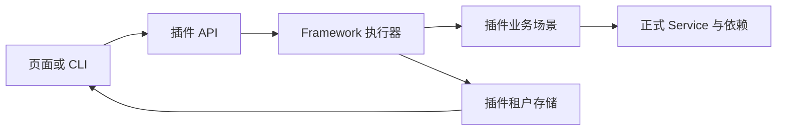
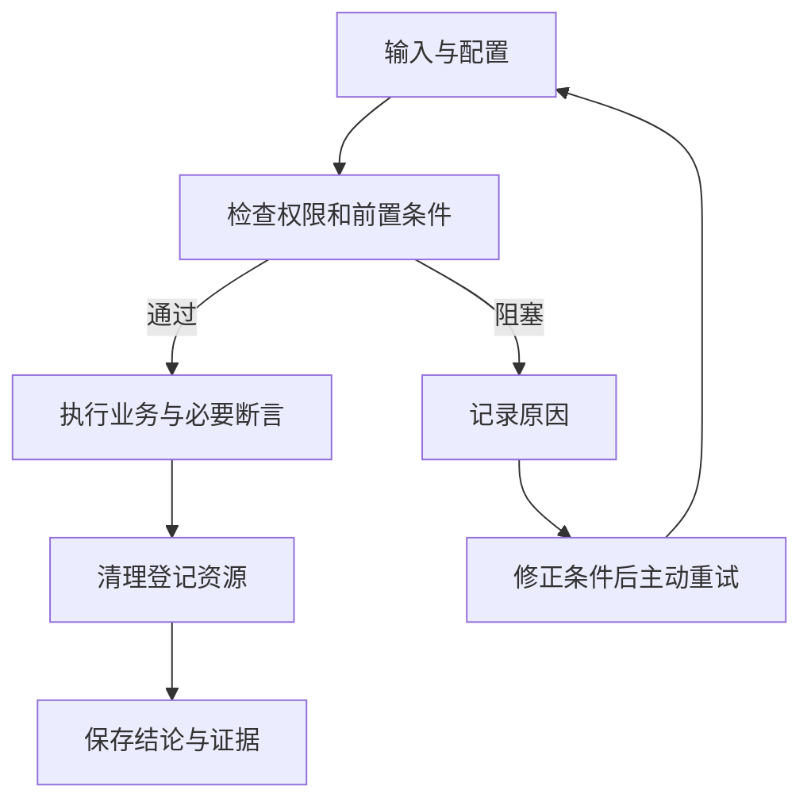
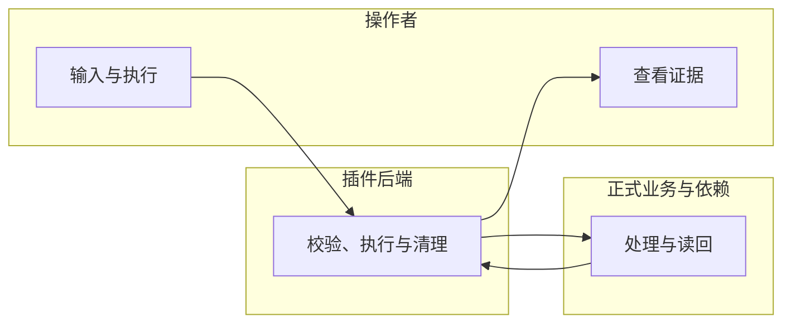

# 其他插件与 CLI 接入

## 1. 功能背景与目标

其他插件实现 Scenario 与 Profile factory，复用 Framework Runner、Store、Client 和工作台。CLI 使用同一 API 与报告结构，--wait 只消费持久化 SSE。

## 2. 角色与适用范围

插件研发、自动化维护者；仅隔离开发／专用测试实例。配置与权限见[总览](guide.md)。

## 3. 整体架构与模块关系



## 4. 核心流程



## 5. 跨角色协作流程



## 6. 前置条件与依赖

启用后端 regression、前端菜单和对应 read／invoke／manage 权限，准备正式业务表与回归三表。配置和迁移命令见[总览第 6 节](guide.md#6-前置条件与依赖)。敏感凭据只通过运行环境提供。页面展示名称，接口传输 UUID。

## 7. 操作步骤

**研发接入动作**：在插件代码注册套件与场景，声明必要断言和 writeOnly 敏感输入，注入正式 Service，创建后立即登记 fixture；提供清理动作。组合 BaseRepository 装配 Store，注册迁移／权限／locale，薄页面注入 API 与可信权限。已有实现可参照 `skeleton/backend/go-gin/internal/services/admin/regression/scenarios/template_lifecycle.go`、`profile.go` 与 `skeleton/web-admin/nuxt/app/pages/admin/regression/index.vue`。编译启动后，预期场景自动出现在目录；没有出现时检查 Registry 注册、profile 支持范围和启动日志。页面中的场景定义由代码维护。

薄页面还须提供 `describeCase(definition)`：返回 `RegressionCasePresentation` 的 `expectationKeys`、`impactKey` 和 `fields`；每个字段声明 `key`、`labelKey`、`control`（text／textarea）及可选 `helpKey`，与输入 Schema 的 string properties 一一对应。默认值通过 `defaultInputs` 提供，所有显示文案注册 locale。当前不支持的复杂输入需明确扩展表单契约，缺失映射会阻止执行，不回退 JSON 编辑。Framework Admin 需要 Valibot peer 依赖。

**页面动作与入口**：管理端 `/admin/regression`。核对场景名称、版本、步骤、验证边界与时限，选择测试配置并执行。查看依赖的声明方式／实际方式、必要断言、清理和历史版本；执行 CLI 后对照标准报告。独立操作步骤见[管理页面指南](usecase-workbench.md)。

**接口动作与入口**：API base 下 `/admin/regression`。先读取 `cases` 与 `profiles`，创建 `runs` 后按返回的批次 UUID读取详情、`events` 和 `report`。取消／清理分别 POST `runs/:run_uuid/cancel`、`runs/:run_uuid/cleanup`。接口返回拒绝时检查标准错误码与权限，不伪造身份。

**本地验证动作**：进入上述测试所属的 Go module，执行：

```bash
REGRESSION_GENERATED_TEST=1 go test ./internal/templates -run RegressionGenerated -count=1
```

在 `tools/cli/` 执行，预期为两个生成后端的对应测试通过；失败时按输出定位 `internal/templates/regression_generated_test.go`，修正后复测。完整生成插件安装、构建、页面与 CLI 验收在仓库根目录运行 `python3 scripts/testing/regression-generated.py`。这两项均不证明真实 Core 授权。

CLI 从仓库根目录执行；输入文件按 case UUID 映射 JSON 对象：

```bash
go run ./tools/cli/cmd/px-plugin regression list --api-base "$REGRESSION_API_BASE" --token-env REGRESSION_TEST_TOKEN --json
go run ./tools/cli/cmd/px-plugin regression run --api-base "$REGRESSION_API_BASE" --token-env REGRESSION_TEST_TOKEN --plugin-id "$REGRESSION_PLUGIN_ID" --profile "$REGRESSION_PROFILE_UUID" --case "$REGRESSION_CASE_UUID" --inputs ./tmp/regression-inputs.json --request-uuid "$REGRESSION_REQUEST_UUID" --wait --report ./tmp/regression-run.json
go run ./tools/cli/cmd/px-plugin regression report --api-base "$REGRESSION_API_BASE" --token-env REGRESSION_TEST_TOKEN --run "$REGRESSION_RUN_UUID" --format junit --output ./tmp/regression-run.xml
```

`--api-base` 包含实际 API 前缀；`--tenant` 可指定已有授权租户 UUID，最终身份由后端验证。网络重试必须复用 `--request-uuid`。先准备输出目录。SDK 当前尚未发布；生成项目验收显式绑定本地 Framework，外部项目正式升级须等待发布后再验证。

## 8. 预期结果与验收标准

使用 Tailwind 4 的现有插件，还需在主样式的 Tailwind 导入后引入 `@artisan-cloud/plugin-framework-admin/layer/assets/css/sources.css`，让公共组件的响应式样式进入构建扫描。Skeleton 和生成模板已包含此入口；这是 [Tailwind 显式注册外部源文件](https://tailwindcss.com/docs/detecting-classes-in-source-files#explicitly-registering-sources) 的标准机制。缺少时即使构建成功，桌面纵向分区等样式也可能未生成。

插件还需在 `describeCase(definition).results` 中按断言 key 声明结果展示。例如内容断言声明 `shape: 'scalar'`，使用一个 `format: 'text'`、插件 locale `labelKey` 的字段；订单结果可声明 `shape: 'record'`，显式列出金额、状态等字段，枚举值映射到 locale。数组对象用 `list` 与 `itemLabelKey`；嵌套字段用 `items`。类型与完整示例以 [SDK 展示契约](../../../../specs/025-framework-business-regression/contracts/scenario-sdk.md#工作台业务展示契约)和 Skeleton `app/composables/regressionPresentation.ts` 为准，不需要复制 Template 表单或结果组件。

资源登记应提供业务 `display_name`、角色 `role_key`，来源关系用已登记同场景资源的 `parent_resource_uuid` 显式关联。清理完成后调用 `Cleaned(ctx, resourceUUID, evidence)`，传入正式读回证据；仅有删除请求成功不能标记已清理。测试应验证资源清理、来源、证据和敏感名称脱敏。字段仍存入现有资源 JSON，无须为这些字段新增表。

两种入口的 profile／定义／断言／verdict／cleanup 字段一致。`run --wait` 通过退出 0、参数／鉴权／HTTP／文件错误退出 1、非通过退出 2、事件中断退出 3 并保留 run_uuid；未等待时退出 0 仅表示提交被接受。多选时重复使用 `--case`，每个参数传一个 UUID。两个生成项目使用本地 Framework 源码构建和执行业务通过；不代表已发布模块可用。

## 9. 代码实现映射

场景／机制测试：`tools/cli/internal/templates/regression_generated_test.go`。通用执行、事件和报告入口见[实现映射](guide.md#9-代码实现映射)。

## 10. 常见问题与排障

忙碌时等待当前作业退出；Schema／UUID 不合规时修正输入；缺证据或必要断言时修正场景。连接断开主动重新读取；清理失败核对原绑定与已登记资源。详见[错误与恢复动作](guide.md#10-常见问题与排障)。

## 11. 回滚与风险控制

清理登记资源并等待退出后关闭开关；保留历史报告。重跑创建新批次，重试清理保留旧 verdict。临时服务由测试脚本创建并在 finally 中关闭，用户启动的服务不作操作。

## 12. 变更记录

2026-10-13：接入当前实现与本地测试；验收边界见[证据](../../../../specs/025-framework-business-regression/evidence/acceptance.md)。
