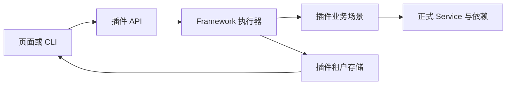
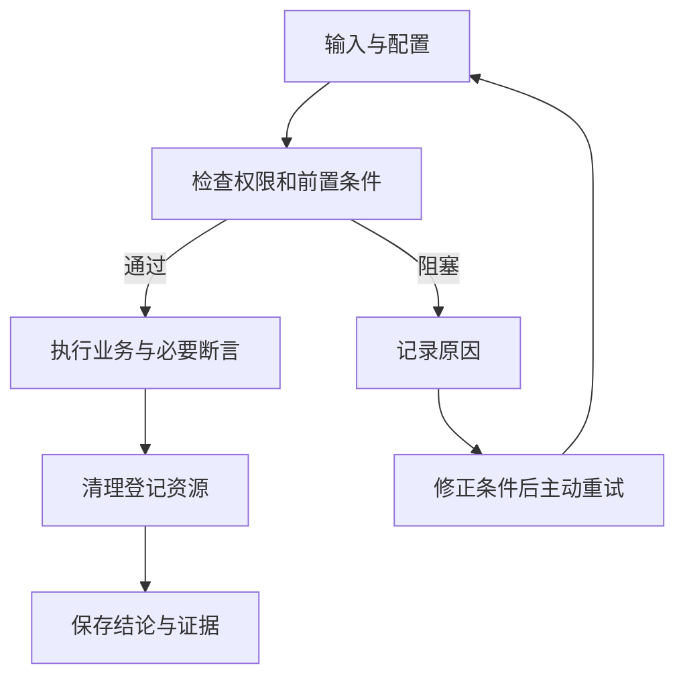
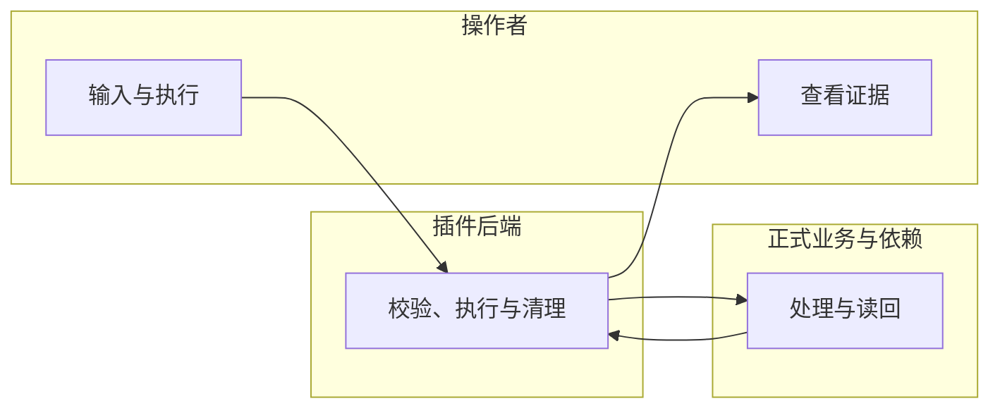

# 受控模板业务回归

## 1. 功能背景与目标

controlled 提供 8 条独立 Template 业务回归，使用真实 TemplateService 与业务数据库。非法输入场景另经插件内真实 HTTP 路由、DTO 和 Handler，注入本次可信执行身份，不经过网络、登录与 Core 授权。每条用例独立准备资源、记录必要断言和证据，清理只删除本次登记的模板。

## 2. 角色与适用范围

业务开发者、测试人员；仅隔离开发／专用测试实例。配置与权限见[总览](guide.md)。

## 3. 整体架构与模块关系



## 4. 核心流程



## 5. 跨角色协作流程



## 6. 前置条件与依赖

启用后端 regression、前端菜单和对应 read／invoke／manage 权限，准备正式业务表与回归三表。配置和迁移命令见[总览第 6 节](guide.md#6-前置条件与依赖)。敏感凭据只通过运行环境提供。页面展示名称，接口传输 UUID。

## 7. 操作步骤

当前插件业务测试环境应显示 8 个用例：

| 用例 | 场景 key | 通过条件 |
|---|---|---|
| 模板创建与修改 | `template.lifecycle` | 创建、修改后正式读回的内容一致 |
| 按名称和说明搜索 | `template.search` | 名称、说明和大小写搜索准确，未匹配查询为空 |
| 模板列表分页 | `template.pagination` | 5 条数据按每页 2 条查询为 2/2/1，总数正确且没有重复或遗漏，末页之外为空 |
| 删除后不可再访问 | `template.deletion` | 删除对象不可读取、不可列出，对照模板不变 |
| 批量复制与副本独立 | `template.clone` | 两个来源各复制两份，4 个副本身份、命名、说明、内容和初始状态正确，修改副本不影响其他对象 |
| 批量复制部分失败 | `template.partialClone` | 有效来源成功，不存在的来源单独失败，只有预期的 1 条副本 |
| 非法输入不污染数据 | `template.invalidInput` | 空白名称和超长内容的创建、修改请求均被 HTTP 拒绝，原模板和数量不变 |
| 内容校验与修复 | `template.validation` | 空内容草稿在普通／严格模式分别报告 warning／error，修复后正式读回并通过校验 |

每条用例的输入由页面预填，可单独运行。批量运行：表头全选当前列表 → “运行选中的 8 个用例” → 核对 8 条业务说明和清理影响 → 按需展开修改输入 → “开始执行”。输入校验失败会展开对应表单，不创建批次。结束后应显示“通过 8 个”和“数据清理成功”。

预期拒绝／部分失败是被验证的业务行为，正确处理时用例为 passed，不误判为回归失败。测试数据不依赖其他用例，不访问现有业务对象；运行记录及技术证据按既有保留策略保存。审核发布、跨租户操作以及客户／联系人场景尚未加入本次 8 条目录。

**页面动作与入口**：管理端 `/admin/regression` 默认进入“回归用例”。在“模板创建与修改”行点击“查看详情”核对目的、通过条件和数据影响，再点击“运行”，核对预填的模板名称、说明、初始内容、修改后内容，点击“开始执行”。请求被接受后进入当次结果，逐项核对创建／修改／重新读取与数据清理；失败差异直接显示，证据与版本在“技术详情”查看。

**接口动作与入口**：API base 下 `/admin/regression`。先读取 `cases` 与 `profiles`，创建 `runs` 后按返回的批次 UUID读取详情、`events` 和 `report`。取消／清理分别 POST `runs/:run_uuid/cancel`、`runs/:run_uuid/cleanup`。接口返回拒绝时检查标准错误码与权限，不伪造身份。

**本地验证动作**：进入上述测试所属的 Go module，执行：

```bash
REGRESSION_EVIDENCE_DIR="$(git rev-parse --show-toplevel)/artifacts/regression" go test ./tests/integration/regression -count=1
```

预期为对应测试通过；失败时按测试输出定位 `skeleton/backend/go-gin/tests/integration/regression/template_lifecycle_test.go` 与 `template_catalog_test.go`，修正后复测。live 的此命令是场景合同测试，不是 Core 授权验收。

## 8. 预期结果与验收标准

通过时 verdict=passed、cleanup_state=succeeded、missing_assertion_keys=[]；8 条整批正序、倒序各执行一次，并分别单独执行，结论相同；已有同租户及其他租户模板不变，测试结束后没有可见残留。`template-catalog-evidence.json` 保存 2 个完整批次、8 个独立批次及最终 active_templates。

## 9. 代码实现映射

场景目录与实现：`skeleton/backend/go-gin/internal/services/admin/regression/scenarios/template_business.go`；HTTP 装配：`internal/services/admin/regression/template_http.go`；业务验收：`skeleton/backend/go-gin/tests/integration/regression/template_lifecycle_test.go`、`template_catalog_test.go`。通用执行、事件和报告入口见[实现映射](guide.md#9-代码实现映射)。

## 10. 常见问题与排障

忙碌时等待当前作业退出；Schema／UUID 不合规时修正输入；缺证据或必要断言时修正场景。连接断开主动重新读取；清理失败核对原绑定与已登记资源。详见[错误与恢复动作](guide.md#10-常见问题与排障)。

## 11. 回滚与风险控制

清理登记资源并等待退出后关闭开关；保留历史报告。重跑创建新批次，重试清理保留旧 verdict。临时服务由测试脚本创建并在 finally 中关闭，用户启动的服务不作操作。

## 12. 变更记录

2026-10-15：扩展到 8 条 Template 用例，补齐真实整批／独立执行、页面全选和 CLI 多用例验收。

2026-10-13：接入当前实现与本地测试；验收边界见[证据](../../../../specs/025-framework-business-regression/evidence/acceptance.md)。
