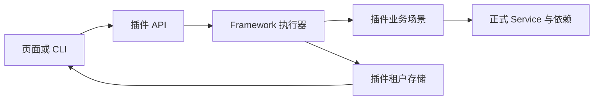
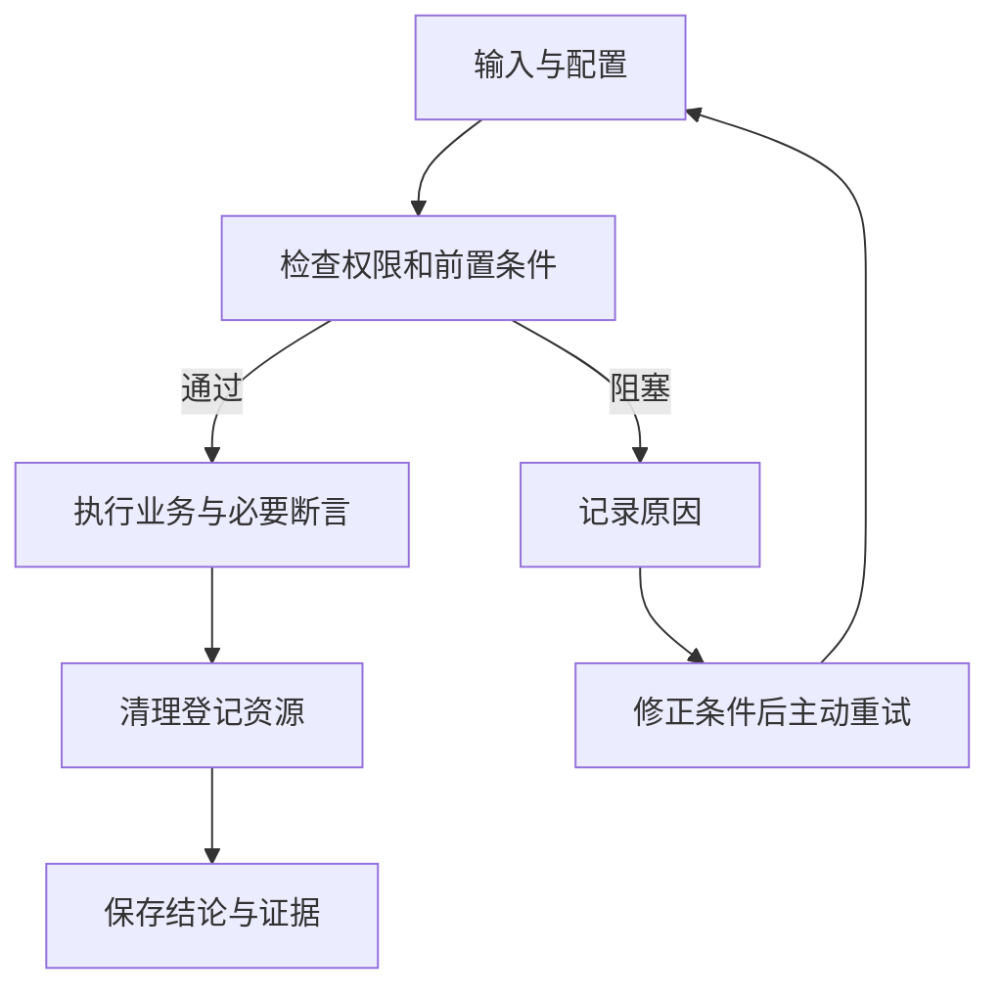
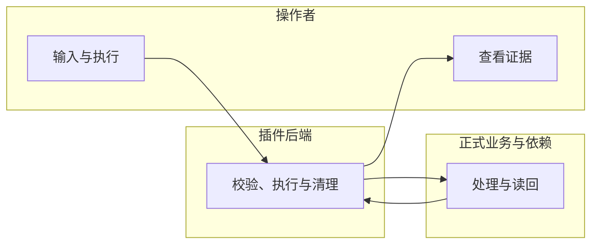

# 历史、取消与清理恢复

## 1. 功能背景与目标

取消通过 context 请求协作式退出，再用独立时限清理。刷新和重新连接先读持久化快照，随后补读 SSE；服务重启不会重放业务。

## 2. 角色与适用范围

测试人员、具备 manage 权限的维护者；仅隔离开发／专用测试实例。配置与权限见[总览](guide.md)。

## 3. 整体架构与模块关系



## 4. 核心流程



## 5. 跨角色协作流程



## 6. 前置条件与依赖

启用后端 regression、前端菜单和对应 read／invoke／manage 权限，准备正式业务表与回归三表。配置和迁移命令见[总览第 6 节](guide.md#6-前置条件与依赖)。敏感凭据只通过运行环境提供。页面展示名称，接口传输 UUID。

## 7. 操作步骤

**页面动作与入口**：管理端 `/admin/regression`。在运行详情点击“取消执行”，等待 cancelled 和清理结论。刷新后在“执行记录”中点击“查看结果”。连接中断时点击“重新连接”。清理失败时恢复原目标配置后点击“重试清理”；不要修改绑定摘要绕过校验。

**接口动作与入口**：API base 下 `/admin/regression`。先读取 `cases` 与 `profiles`，创建 `runs` 后按返回的批次 UUID读取详情、`events` 和 `report`。取消／清理分别 POST `runs/:run_uuid/cancel`、`runs/:run_uuid/cleanup`。接口返回拒绝时检查标准错误码与权限，不伪造身份。

**本地验证动作**：进入上述测试所属的 Go module，执行：

```bash
GOWORK=off go test -race ./runtime/regression/...
```

预期为对应测试通过；失败时按测试输出定位 `framework/backend/go/runtime/regression/lifecycle.go`，修正后复测。live 的此命令是场景合同测试，不是 Core 授权验收。

## 8. 预期结果与验收标准

取消期间显示 cancelling；退出后才能终结。清理重试更新 cleanup_state、事件与 revision，同时保留原 verdict。身份切换关闭订阅并清空旧快照。

## 9. 代码实现映射

场景／机制测试：`framework/backend/go/runtime/regression/lifecycle.go`。通用执行、事件和报告入口见[实现映射](guide.md#9-代码实现映射)。

## 10. 常见问题与排障

忙碌时等待当前作业退出；Schema／UUID 不合规时修正输入；缺证据或必要断言时修正场景。连接断开主动重新读取；清理失败核对原绑定与已登记资源。详见[错误与恢复动作](guide.md#10-常见问题与排障)。

## 11. 回滚与风险控制

清理登记资源并等待退出后关闭开关；保留历史报告。重跑创建新批次，重试清理保留旧 verdict。临时服务由测试脚本创建并在 finally 中关闭，用户启动的服务不作操作。

## 12. 变更记录

2026-10-13：接入当前实现与本地测试；验收边界见[证据](../../../../specs/025-framework-business-regression/evidence/acceptance.md)。
