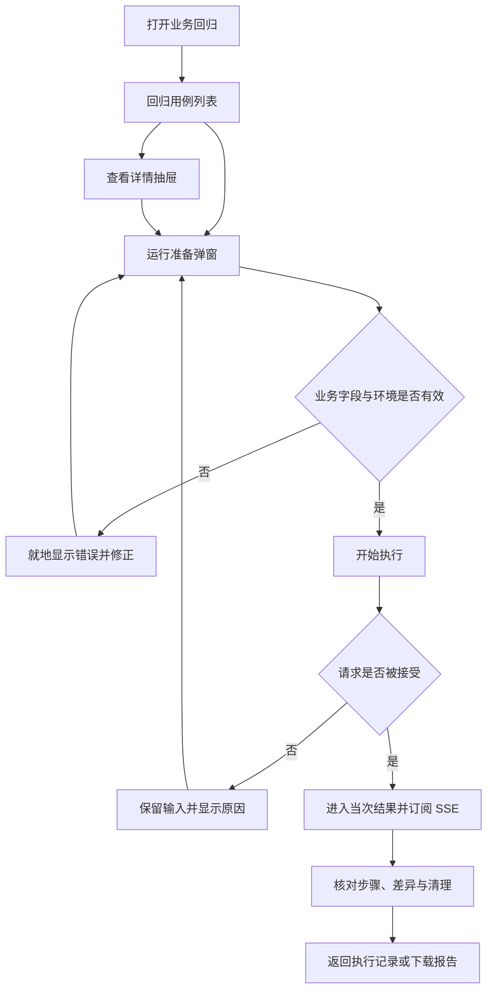
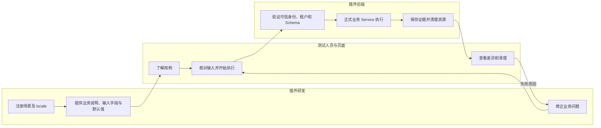

# 回归用例管理页面

## 1. 功能背景与目标

帮助插件研发和测试人员完成“了解要测的业务 → 准备测试输入 → 执行 → 看懂结果 → 回看历史”。默认进入用例列表；执行记录使用独立标签页，结果进入当次详情。技术资料通过明确的“技术详情”按钮查看。

场景由插件代码注册维护；一个用例对应一条可独立执行的业务场景。当前插件业务测试环境有 8 个可独立执行的 Template 用例，覆盖创建与修改、搜索、分页、删除、批量复制、副本独立、部分失败、非法输入和内容修复。其中“模板创建与修改”内部包含创建、修改、重新读取三个步骤，步骤不另算用例。完整目录见[受控模板业务回归](usecase-controlled.md#7-操作步骤)。

## 2. 角色与适用范围

研发负责注册场景、业务说明和输入表单；研发或测试人员运行并核对结果；环境负责人维护测试实例和真实集成资源。查看需要 `regression:read`，执行需要 `regression:invoke`，取消及清理需要 `regression:manage`。仅适用于显式启用的开发／测试环境。

## 3. 整体架构与模块关系


| 位置 | 用户任务与内容 |
| --- | --- |
| 回归用例标签页 | 查看当前环境的用例数量、验证目的、最近批次结论；选择单条或多条运行 |
| 查看详情抽屉 | 测试目的、内部步骤、通过条件及数据影响；可继续进入运行准备 |
| 运行准备弹窗 | 核对环境、使用或修改预填业务字段；点击“开始执行”才提交业务操作 |
| 执行记录标签页 | 按时间查看批次包含的用例、总体结果与清理状态 |
| 当次结果概览 | 批次结论、必要校验通过数、耗时、清理数量及每个用例的结果 |
| 业务校验分区 | 当前用例每项校验的预期／实际；大结果按需查看完整对比 |
| 测试数据与清理分区 | 资源名称、源对象／副本角色、显式来源关系、逐项清理时间与读回证据 |
| 执行与诊断分区 | 当前用例步骤、计时、版本、依赖声明／实际方式；原始技术快照按需打开 |

## 4. 核心流程



## 5. 跨角色协作流程



## 6. 前置条件与依赖

按[总览第 6 节](guide.md#6-前置条件与依赖)准备隔离实例、正式业务表与回归三表，启用后端 regression 并配置 profile。前端设置 `NUXT_PUBLIC_REGRESSION_ENABLED=true`，侧栏“插件能力”组应出现“业务回归”。缺表不由页面自动迁移。

当前 controlled 类型在页面显示为“插件业务测试环境”，使用正式业务 Service 和存储；live 类型显示为“Core 集成测试环境”，需要专用租户／资源及已有授权。页面没有授予 Core 权限的能力，真实集成准备见 [live 指南](usecase-live.md)。

公共工作台需要插件提供 `describeCase` 和 `defaultInputs`。前者声明通过条件、数据影响、业务表单字段的 i18n key；后者提供默认值。当前支持 Schema 中的 string 字段，控件为 text／textarea，由 Valibot 与后端 Schema 分别校验。缺少完整映射时明确报错并禁用开始按钮，不回退为 JSON 输入。Framework Admin 的 Valibot peer 依赖已包含在 Skeleton 依赖中。

## 7. 操作步骤（按场景拆分）

### 7.1 了解并运行模板用例

1. 登录测试实例，打开侧栏“插件能力 → 业务回归”，或访问 `/admin/regression`。默认选中“回归用例”，顶部显示可运行数量与当前环境。只有 controlled 配置时应为 8 个用例；没有目录时检查配置、权限和请求错误。
2. 查看“模板创建与修改”这一行的“验证什么”：创建、修改后重新读取，确认内容一致。点击“查看详情”，预期抽屉展示测试目的、三个步骤、通过条件及创建／清理测试数据的影响。缺少业务说明时联系插件研发补齐。
3. 点击行内或抽屉中的“运行”。预期出现运行准备弹窗，此时尚未提交执行请求。核对环境与预填的测试模板名称、说明、初始内容、修改后内容；不必填写 JSON。
4. 保留默认值或修改业务字段。必填项为空时点击“开始执行”，预期字段旁显示具体错误，页面保留输入且不创建批次。按提示补齐后重试；点击“返回”则关闭准备，不执行测试。
5. 点击“开始执行”。202 表示已接受，页面关闭弹窗并进入“执行记录”中的当次详情；以最终结论和清理状态判断成功。请求被拒绝时弹窗保留原输入并显示原因，修正后主动重试。
6. 批量执行时逐条勾选，或使用表头复选框全选当前列表，页面才出现“运行选中的 N 个用例”；点击后先核对每条用例的目的和数据影响。默认输入已填好，按需展开“核对或修改测试输入”；输入有错时自动展开对应表单。确认后点击“开始执行”，整批 8 条会逐条运行并分别报告结果。切换环境清空筛选与选择；筛选后移除隐藏的选择，防止误带未显示的用例。

### 7.2 看懂结果与定位失败

1. 先看顶部结论、用例数量、必要校验通过数、耗时和清理数量。默认“结果概览”只列各用例结论，业务通过且清理符合要求才算通过。“已结束”不等于“通过”。
2. 点击目标用例的“查看业务校验”。桌面左侧四个分区一次只显示当前内容；窄屏使用可横向滚动的分区导航。批量结果右上可切换当前查看用例，分区切换和实时更新会保留选择。
3. 在“业务校验”同时核对预期和实际，通过项也能检查。例如复制用例可核对 4 条副本的名称、说明、内容和状态；字段较多时点击“查看完整对比”打开抽屉。缺少展示映射或实际字段时明确提示，不能当作通过事实。
4. 在“测试数据与清理”检查源模板／副本名称和来源。复制用例应有 2 条源模板、4 条副本，并各有清理时间与读回证据；点击“查看清理证据”可查看正式删除后读取的 `exists=false` 事实。历史记录未保存这些字段时显示缺失提示，不补造证据。
5. 失败位置、清理失败和连接异常在所有分区持续可见。点击“定位失败”直接进入当前失败用例与差异抽屉；清理失败可检查资源后“重试清理”；断线需主动“重新连接”，没有轮询兜底。取消后等待协作退出和清理，关闭页面不取消执行。
6. 在“执行与诊断”核对当前用例的步骤、时间、版本和实际依赖，按需打开“技术详情”。业务界面优先显示名称，UUID 只在技术证据和报告中展示。缺失版本显示“未记录”，未结束的耗时显示“尚无完整计时”。
7. 修正问题后点击“重跑失败场景”，页面带回该批次保存的输入，重新进入运行准备；未保存的敏感字段需要重新填写。核对后开始创建关联原记录的新批次。取消准备不会重跑；原环境已移除时明确报错。

### 7.3 查看执行记录

1. 点击“执行记录”标签页，预期看到时间、执行用例、整批结果和数据清理。首次无记录时按空状态入口返回用例列表。
2. 点击“查看结果”进入该批次详情；点击“返回执行记录”回到列表。离开该标签页再返回时显示记录列表，避免被旧详情占住入口。
3. 刷新后默认进入用例列表，仍可从执行记录打开原快照。目录中的“最近批次结果”来自当前环境已加载的历史，是整批结论；单个用例结论在详情核对。
4. 点击“下载报告”导出 JSON，JUnit 使用 CLI 的 `report --format junit`；报告判定和字段一致。

### 7.4 接口核对

以下仅查询目录，凭据通过环境变量提供：

```bash
curl -fsS \
  -H "Authorization: Bearer ${REGRESSION_TEST_TOKEN}" \
  -H "X-Tenant-UUID: ${REGRESSION_TENANT_UUID}" \
  "${REGRESSION_API_BASE}/admin/regression/cases"
```

预期响应包含 `{"success":true,"data":{"items":[{"key":"template.lifecycle","version":"v1"}]}}`。401／403 检查身份与权限，404 检查启用配置与运行版本，503 检查存储。不得伪造身份或用业务无关 200 响应代替验收。

### 7.5 本地验收

在仓库根目录运行，需要前端依赖、Playwright Chromium 与 Go 工具链：

```bash
REGRESSION_BROWSER=1 bash scripts/testing/regression.sh
```

脚本构建并启动自有临时 Go／Nuxt 服务，验证业务与页面后关闭服务。预期正常报告 verdict=passed、cleanup_state=succeeded，active_templates=0，临时端口 released=true。失败时检查 `artifacts/regression/browser-backend.log`、`browser-ui.log`、Playwright 输出和 `browser-business-evidence.json`。

## 8. 预期结果与验收标准

- 第一次进入即可辨认用例数量、每行验证目的、最近批次状态和运行入口；内部步骤独立计数。
- 查看说明、核对输入、运行和结果分别位于清晰的交互位置；无顶部“运行全部”与行内运行争夺主操作。
- 默认业务表单可直接提交；校验错误不发起执行，返回准备不创建批次；批量准备保留各用例上下文。
- 通过、失败、取消、清理和历史能真实核对；失败差异可直接阅读，敏感／技术资料在明确的技术入口查看。
- 结果默认只显示概览；桌面纵向分区、窄屏导航可用，切换分区／用例和 SSE 更新保留上下文，主要异常始终可见。通过项也显示业务事实，资源关系不从名称推断，清理必须有正式读回证据。
- read 用户可查看说明与结果，invoke／manage 动作按权限开放；身份或租户变化清理旧数据和订阅。
- 本地测试身份与 SQLite 业务证明不替代真实安装态身份和 Core 授权，T045 仍见[真实集成记录](../../../../specs/025-framework-business-regression/evidence/live-integration.md)。

## 9. 代码实现映射

| 行为 | 实现 |
| --- | --- |
| 插件权限、默认值、业务说明与表单映射 | `skeleton/web-admin/nuxt/app/pages/admin/regression/index.vue` |
| 列表、Tab、详情抽屉与运行准备 | `framework/frontend/nuxt/framework-admin/layer/app/components/powerx/PXRegressionWorkbench.vue` |
| 结果、步骤差异与技术快照 | `framework/frontend/nuxt/framework-admin/layer/app/components/powerx/PXRegressionRunDetail.vue` |
| 插件输入展示契约 | `framework/frontend/nuxt/framework-admin/layer/app/types/regression.ts` |
| SSE、快照与恢复动作 | `framework/frontend/nuxt/framework-admin/layer/app/composables/usePowerXRegression.ts` |
| 后端场景、路由与权限 | `skeleton/backend/go-gin/internal/services/admin/regression/`；`internal/transport/http/admin/regression/` |
| Locale 与页面验收 | `skeleton/web-admin/nuxt/i18n/locales/{zh,en}.json`；`tests/e2e/regression-workbench.spec.ts` |

## 10. 常见问题与排障

| 现象 | 处理 |
| --- | --- |
| 菜单不可见 | 检查前端开关和 read 权限；后端另有启用配置 |
| 目录 404 | 检查后端 regression 配置、回归三表和实际运行版本，重新加载需遵守服务授权边界 |
| 数量仍只有一个 | 当前版本的 controlled 应有 8 条；检查后端运行版本和当前筛选条件。创建、修改、读取是其中一条的内部步骤，不另计数 |
| 缺少业务表单 | 插件补齐 `describeCase`，字段 key 与 Schema properties 一一对应，并注册 locale |
| 表单报错 | 按字段提示修正；UUID 格式字段不能填显示名或任意字符串 |
| 忙碌不能执行 | 查看现有执行记录，等待执行或清理结束；必要时主动刷新 |
| 最近批次失败但某用例通过 | 列表显示整批结论，进入详情看各用例结论 |
| 连接或清理失败 | 明确修正原因后重连或重试清理，见[恢复指南](usecase-recovery.md) |

## 11. 回滚与风险控制

关闭功能前等待或协作取消当前执行，核对资源清理并保留历史。切换页面不取消后台任务；测试身份、真实 Core 授权、正式发布模块分别验收。临时服务由脚本关闭并核对端口，不能操作用户日常进程。

## 12. 变更记录

2026-10-15：依据产品交互规范重组为用例列表与执行记录两个标签页，增加说明抽屉、业务输入准备弹窗及独立结果详情；其他插件通过 `describeCase` 提供业务字段与 locale，技术快照集中查看。后端执行与报告契约不变。

2026-10-17：结果详情改为四个任务分区；插件声明结果字段显示，新增资源业务名称、显式来源及逐项清理读回证据。沿用现有 JSON 快照存储，未新增表。

同日经用户追加确认，完成独立运行模式的窄屏主导航抽屉、紧凑顶栏和内容区缩放。左上角菜单打开／关闭不会丢失当前回归用例或结果分区。共享组件 CSS source 入口已纳入 Skeleton 与双模板主样式。
