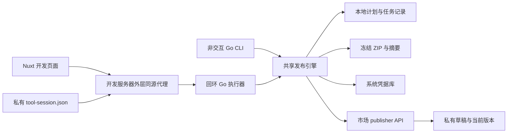
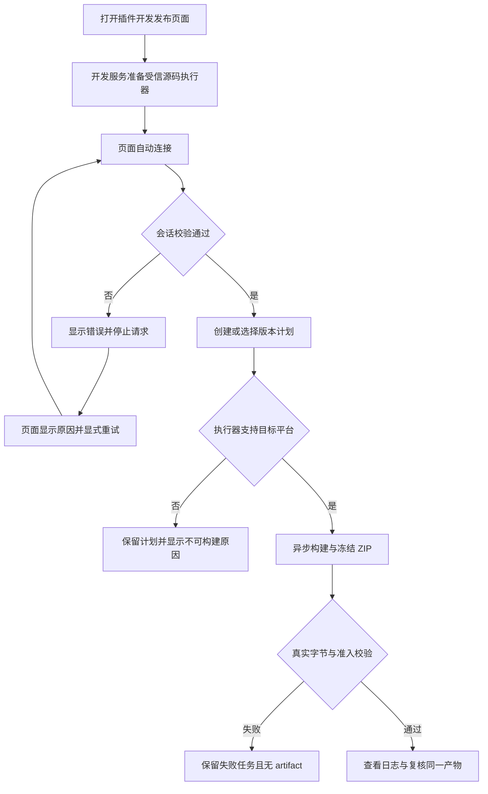
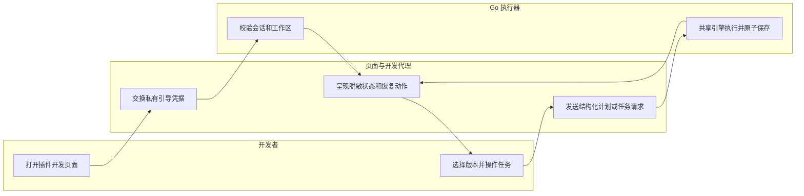

# 开发者发布中心：计划、构建与市场上传

版本 0.10，2026-11-17 更新。Base 0.1.5 已通过页面构建，Market 修复准入后，同一原包已在发布页面真实上传并提交审核。丢响应、页面刷新和本地执行器重启后可恢复原任务及回执；修正送审后刷新完整集合的只读状态门禁。驳回重提、批准与上架由市场维护者配合后继续验收，具体见[本轮页面证据](../../../contracts/evidence/plugin-publisher-base-page-joint-validation-20261117.json)和[协作步骤](../../../marketplace/plugin-publisher-base-review-coordination-20261117.md)。SDK/CLI 尚未正式发布；正式市场、Linux Secret Service、公开下载和 PowerX 安装另行验收。

## 1 功能背景与目标

开发者可以在同一个页面选择发布版本、构建平台和任务，核对被冻结的真实文件。创建计划只产生本地记录；本地包就绪不等于市场已接收、审核或公开上架。

## 2 角色与适用范围

适用于研发与测试，在有源码的本地 Nuxt 开发环境使用。页面入口为 `/powerx/publisher`，也可从开发态侧边栏“开发者发布中心”进入。页面沿用后台顶栏与主菜单，发布步骤保留为页面内分区；语言与主题使用顶栏统一控制。打开页面后由开发服务自动识别当前插件工作区、准备同版执行器并连接。页面不要求启动 CLI、填写工具路径或配置配对环境变量。生产不注册页面与执行代理。功能来自 Framework Admin Layer 当前源码，尚未正式发布 SDK 或更新全局 CLI。

| 文档 | 角色 | 独立验收口径 |
| --- | --- | --- |
| 本指南 | 研发、测试 | 从自动连接到版本计划、构建安装包、市场授权及上传的页面主链路 |
| [本地工具契约](../../../contracts/plugin-publisher-local-v1.md) | 接入研发 | 会话、记录及 Go 接口 |
| [构建及发布包准入](../../../contracts/plugin-publisher-build-v1.md) | 构建维护人 | 隔离构建、真实字节、运行时目标及包限制 |

## 3 整体架构与模块关系



代理只在 Nuxt development 模式注册。它保留真实网络连接的 peer 地址，校验回环 peer、精确 Host、页面 Origin 和专用 intent 请求头，不能改成丢失 socket 信息的 Nitro worker 路由。浏览器请求不携带业务 JWT 或 Cookie；代理只向本地执行器传递独立工具会话。

## 4 核心流程



## 5 跨角色协作流程



## 6 前置条件与依赖

- 使用当前 Framework Admin Layer、Go 1.24+ 和现有 Nuxt 开发依赖。当前 Base／Framework 源码仓库自动编译同版工具及容器内校验工具。本轮以 Base 为真实包验收对象；独立插件的同版 CLI 开发依赖与 Linux 构建工具随后续 SDK/CLI 工件单独交付，不把源码仓库自动编译视为已发布包消费通过。
- 发布页仅在开发态开放，绑定 Nuxt 服务端识别的唯一受信插件工作区。浏览器不能指定任意目录或命令。
- Apple 芯片 Mac 和 Linux / amd64 具备匹配的 Go、Node.js 构建工具时，页面默认直接构建 Linux / amd64 安装包。需要容器时，在“更多 → 构建设置”选择。Market 对 Mac 构建包的准入进度见[联合验收交接](../../../marketplace/plugin-publisher-direct-make-dist-handoff-20261119.md)。
- 构建容器不挂载宿主源码原件、home、Docker socket、dotenv 或系统钥匙串。依赖在独立副本中安装，源文件保持不变；只复制锁定模块的下载缓存。
- 市场发布令牌通过页面一次性私密提交，由本地执行器验证后保存至 macOS Keychain／Linux Secret Service。浏览器状态、日志、任务记录和容器不保留令牌。

## 7 操作步骤（按场景拆分）

### 7.1 打开发布页面

照常启动插件开发前端后，从侧边栏进入“开发者发布中心”，或打开 `http://127.0.0.1:3131/powerx/publisher`。页面自动准备执行器并恢复当前插件的计划与任务，不需要再打开终端运行发布命令或添加配对变量。

准备失败时，页面显示原因并提供“重新连接”；不会结束其他执行器或重放已有构建、上传及送审操作。Nuxt 关闭时清理自己启动的执行器与子进程，保留计划、冻结包和原操作记录。

### 7.2 页面操作

1. 打开页面后等待自动连接，核对插件名称和源码版本；若失败，读取错误并点击“重新连接”。
2. 默认进入“版本管理”，点击“创建版本计划”，填写如 `1.2.0` 的稳定版本及更新说明。预期本地计划入库、当前版本切换；错误时保留输入；结果不明时阻止再次创建或构建，须先关闭弹层并显式刷新核对已有记录，不能直接重发。
3. 进入“构建打包”，点击“开始构建”。若上次构建失败，点击“重新构建”开始新任务，旧任务保留在“构建历史”。若提示发布工具需要更新，点击“重新连接发布工具”，再开始构建。运行平台和构建方式可在“更多 → 构建设置”查看。
4. 运行状态、错误和取消入口保持在分区外。可以切换标签页继续查看；选择其他版本也不能隐藏正在运行的任务。
5. 构建终态停止自动查询。查看日志或点击“复核发布包”，预期复核原 ZIP 的摘要、大小及包准入；不重新构建或压缩。失败时保留记录并核对日志或源码。
6. 进入“市场连接”添加名称、API 根地址和独立批准的控制台地址。地址填错时，打开“连接详情”并点击“更正地址”，修改后点击“保存并切换”。页面选中新连接，原连接仍可用于查看和恢复旧任务。点击“绑定发布令牌”，在市场网页创建令牌，再回到发布中心粘贴并点击“验证并保存授权”。提交或关闭弹窗后清空输入。
7. 进入上传分区，选择目标市场和已冻结版本，确认上传为私有草稿。传输进度、市场处理、回执和当前版本分别展示；完成后打开市场版本查看。上传不自动提交审核或公开上架。
8. 断网、取消或重启后选择原任务，点击“核对并恢复原操作”；沿用同一 operation 和冻结包。若写响应不确定，先显式刷新已有记录，再继续操作，不能反复创建新任务。

桌面为左侧纵向分区，窄屏显示紧凑横向分区。选中计划、任务、市场连接与分区保存在路由参数中，UUID 仅作内部引用；普通界面显示版本和时间，技术详情才显示任务 UUID。语言及主题沿用应用 i18n 和 color mode。

### 7.3 发布令牌绑定与恢复

在“市场连接”选择目标，点击“绑定发布令牌”。“打开市场令牌管理”只打开已批准控制台下的固定页面；上传需 `plugins:read/packages:write`，送审另需 `publications:read/publications:submit`。在市场网页创建令牌后，通过密码输入框提交，服务端校验 discovery、身份、插件归属和权限后写系统凭据库。页面只接收脱敏身份与权限信息。

令牌不进入 URL、localStorage、路由参数、日志、任务记录或构建容器。绑定失败也清空输入并显示错误；结果不明时先验证当前连接。换发令牌必须属于同一用户及开发者，不能更换身份恢复原操作。

取消、断网或重启后，在“上传与恢复”核对并恢复原任务，沿用原 operation 和冻结 ZIP。市场能力未开放时明确显示未就绪；启动市场服务不等于开放上传和送审能力。

### 7.4 资料与送审（F08／P07）

1. 在“资料与送审”选择目标市场和已上传版本。凭据需要 publications:read/publications:submit，市场需开放 publication-submit/idempotent-writes；上传权限不包含送审。
2. 点击填写资料，从市场读取当前完整平台集合与许可证／Core 版本选项。全部平台包参与送审，不能仅选择主包；集合变化必须重新核对。
3. 在“发布资料／安全与隐私”两个分区填写资料。切换分区保留草稿；许可证与最低 Core 版本不制造默认值。
4. 预览规范化后的全部资料及制品，再显式确认送审。回执仅表示申请已登记，不代表批准或公开上架。
5. 网络中断或取消后核对原任务，恢复沿用同一 operation。已登记申请停止自动查询，之后显式刷新原申请状态；市场记录按需进入分页弹层。
6. 驳回后先刷新原记录，再修订资料、重新核对完整集合并确认，创建新的送审操作。旧快照和回执保持不变。

市场已交付 P07 及 M2 scopes，默认关闭；选定实例缺少能力或当前凭据缺少权限时，页面显示原因并禁用新送审。不得以受控 fixture 截图或回执代替真实审核、公开上架和下载。完整说明见[送审适配契约](../../../contracts/plugin-publisher-submission-v1.md)。

请求关联：在上传或送审任务的“技术详情”点击“读取请求记录”，按页核对客户端／市场请求 UUID、HTTP 状态和时间。提交回执的审核申请 UUID 与版本 UUID 也在技术详情中；无响应时恢复原 operation，不用新任务绕过。

### 7.5 接口调用

以下读取代理会话状态，不消耗引导凭据，也不携带业务登录凭据：

```bash
curl http://localhost:3131/__powerx/publisher-api/status \
  -H 'Origin: http://localhost:3131' \
  -H 'X-PowerX-Publisher-Origin: http://localhost:3131' \
  -H 'X-PowerX-Publisher-Intent: local-publisher'
```

首次连接前的预期响应：

```json
{"data":{"connected":false}}
```

页面显式 `POST /__powerx/publisher-api/connect` 交换引导凭据；`GET /info` 返回脱敏工作区信息。其余白名单为 `/plans`、`/builds`、`/markets`、`/uploads` 的固定资源及相应日志、复核、验证、取消、恢复和版本分页路径，固定映射到 Go `/v1` 路由，不提供任意目标代理。

## 8 预期结果与验收标准

- 计划创建不修改源码 manifest；刷新后从执行器恢复选中计划与任务。
- 任务查询是本地工具的首选传输，每 2 秒一次；构建页面查询窗口最多 30 分钟，上传页面查询窗口最多 2 小时，市场操作恢复仍受 120 秒轮询窗口及 7200 秒总预算约束；终态、错误和离开页面后停止。暂停后由用户继续查询同一任务，不重放构建写请求。
- 主界面、错误、焦点、悬停、选中、禁用及弹层在 1440/390 像素、浅深色、手动与系统主题相反组合中实际渲染，普通文字至少 4.5:1。
- 生产产物无发布中心路由和代理处理代码。Nuxt SPA 对未知 URL 可能返回 200 HTML 外壳；该响应不是 publisher JSON，也不能执行本地任务，应同时核对客户端路由和产物代码。
- [F05 验证记录](../../../contracts/evidence/plugin-publisher-ui-validation-20261110.json)分别记录真实 Go 计划操作与受控构建页面样例，不把样例计作真实 Linux/Nuxt、市场上传或完整生成插件验收。
- [主导航与开发入口验证记录](../../../contracts/evidence/plugin-publisher-shell-validation-20261114.json)覆盖 `/powerx/publisher`、共享后台导航、真实本地计划创建、分区与草稿保留，以及浅深色桌面和窄屏截图；此次未重新执行市场上传或安装验收。更新开发模块后，需要重启 Nuxt 加载新的执行器管理方式。

```bash
npm --prefix skeleton/web-admin/nuxt run test:unit -- tests/unit/publisher-proxy.spec.ts tests/unit/publisher-workspace.spec.ts tests/unit/publisher-page.spec.ts tests/unit/publisher-market.spec.ts tests/unit/publisher-review.spec.ts tests/unit/publisher-request-trace.spec.ts tests/unit/layout-routing.spec.ts
node scripts/sync-templates.mjs --check
```

当前 M1 验证、版本摘要、隔离资源及清理记录见[本轮证据](../../../contracts/evidence/plugin-publisher-m1-validation-20261110.json)；此前 F05 记录保留为历史证据。F08 的完整集合、送审恢复及页面受控结果见[送审验证记录](../../../contracts/evidence/plugin-publisher-f08-validation-20261111.json)。

## 9 代码实现映射

| 行为 | 实现位置 |
| --- | --- |
| 开发态路由和代理注册 | [publisher/module.ts](../../../../framework/frontend/nuxt/framework-admin/publisher/module.ts) |
| 页面和 locale | [PublisherPage.vue](../../../../framework/frontend/nuxt/framework-admin/publisher/runtime/PublisherPage.vue)、publisher/locales |
| 私有引导、边界与路由白名单 | [proxy.ts](../../../../framework/frontend/nuxt/framework-admin/publisher/proxy.ts)、runtime/handler.ts |
| 专用客户端、轮询和选中状态 | [client.ts](../../../../framework/frontend/nuxt/framework-admin/publisher/client.ts)、workspace.ts |
| 导航与生成模板 | Skeleton AppSidebar、layout middleware；`scripts/sync-templates.mjs` 同步到 scaffold 和 CLI 内嵌模板 |
| 送审表单、任务与驳回修订 | [ReviewPanel.vue](../../../../framework/frontend/nuxt/framework-admin/publisher/runtime/ReviewPanel.vue)、review-workspace.ts；Go submission.go、submission_server.go |
| 自动化检查 | Skeleton `tests/unit/publisher-*.spec.ts`，CI frontend job |

## 10 常见问题与排障

| 现象 | 核对与恢复 |
| --- | --- |
| 仍提示未配置代理 | 旧开发服务尚未加载自动执行器模块；重新运行 Web Admin 开发任务，再从菜单打开发布中心 |
| Host/Origin 被拒绝 | 使用本机开发服务的回环地址；页面与代理使用实际监听端口核对来源，LAN 和跨站访问会被拒绝 |
| 引导或会话到期 | 点击重新连接；开发服务刷新私有引导并连接原执行器，任务和原操作保留 |
| 构建按钮禁用 | 核对是否选择了版本，以及本机 Go、Node.js 和构建工具是否可用。选择容器时核对本机容器环境状态 |
| 任务查询失败或暂停 | 保留任务，刷新或继续查询同一任务；不自动生成新任务掩盖旧结果 |
| 送审不可用 | 核对 publication-submit/idempotent-writes 及 publications:read/publications:submit；目标实例未公告能力或未授予权限时保留禁用状态 |
| 申请结果待核对 | 刷新本地任务后恢复原操作；不要通过新建任务绕过未知结果 |
| 复核失败 | 核对原产物是否变化及 F03 包准入错误；不拿重新压缩的文件冒充原产物 |

## 11 回滚与风险控制

关闭 Nuxt 开发任务时，自动关闭其管理的执行器与子进程，保留 `.px-plugin/publisher` 内的计划和任务。配置和会话不进入生产 public runtime config；代理不转发业务 Authorization/Cookie，不跟随上游重定向，不暴露令牌或本机文件路径。源码回滚仅处理本功能文件，不清理其他工作区改动或用户服务。

## 12 变更记录

| 日期 | 版本 | 责任与范围 |
| --- | --- | --- |
| 2026-11-10 | 0.5 | Framework F05 本地页面、开发代理、Nuxt UI/i18n、模板导航同步与受控浏览器验证；未实施市场上传 |
| 2026-11-10 | 0.6 | Framework M1 市场连接、系统凭据、异步上传与恢复、版本分页和页面；独立 tarball/Go 模块代理消费、隔离市场与 MinIO 联调；正式发布和生产验收保留 |
| 2026-11-11 | 0.7 | F08 资料选项、完整集合、送审任务、恢复及驳回修订源码；当时市场 P07 未交付，真实 M2 验收保留 |
| 2026-11-11 | 0.8 | 对齐已交付的 P07、新 Publication UUID 及 M2 scopes；增加请求 UUID 的持久化、分页技术详情和固定错误诊断；真实联合验收单列 |
| 2026-11-11 | 0.9 | Framework 实际 SDK/CLI 生成插件的开发页面连接真实隔离市场，受控包 M2 主链路通过；原生包与剩余验收单列 |
| 2026-11-16 | 0.10 | 自动管理执行器、页面 Linux 容器构建和私密凭据绑定；Base 0.1.5 实际包与 Nuxt 容器启动通过，真实市场上传暴露 P04 Schema ID 误判，Market 维护者负责市场修复与回传，Framework 接续自己的页面验收 |

2026-11-11 的历史 M2 场景与环境交接见[联合记录](../../../marketplace/plugin-publisher-framework-m2-joint-record.md)，未执行项保持待执行。

2026-11-11 历史页面验证：送审、丢响应及执行器重启恢复、驳回重提、批准仍私有、显式上架、旧申请链接和同身份只读换发均通过。输入为 Market 已通过真实上传接口登记的受控草稿；Framework 原生构建上传、公开下载与 PowerX 安装未验收。详见[新证据](../../../contracts/evidence/plugin-publisher-m2-page-joint-validation-20261111.json)。

本轮完整 GUI 改造及实际页面验证见[GUI 发布验证记录](../../../contracts/evidence/plugin-publisher-gui-validation-20261116.json)。历史记录保留，不能将容器构建或隔离市场结果写作正式上架和 PowerX 安装验收。

页面截图：[发布包就绪](../../../contracts/evidence/plugin-publisher-gui-20261116/build-ready.png)、[浅色授权弹窗](../../../contracts/evidence/plugin-publisher-gui-20261116/desktop-light-bind.png)、[深色授权弹窗](../../../contracts/evidence/plugin-publisher-gui-20261116/desktop-dark-bind.png)、[窄屏浅色](../../../contracts/evidence/plugin-publisher-gui-20261116/narrow-light-bind.png)、[窄屏深色](../../../contracts/evidence/plugin-publisher-gui-20261116/narrow-dark-bind.png)。
