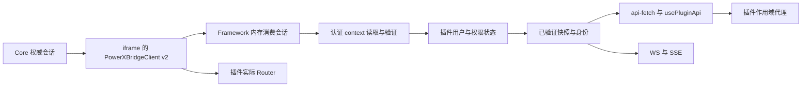
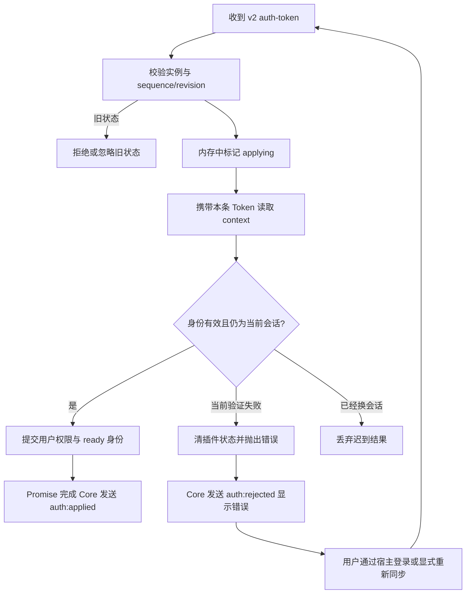
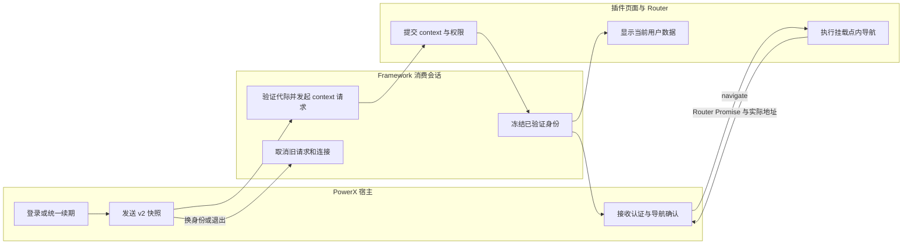

# 插件前端桥接 v2 接入指导

## 1. 功能背景与目标

Framework client 的本地源码将嵌入页面的认证、请求与导航统一到 Core 桥接 v2。源码和模板已经对齐；本轮不提升版本号或打包发布，真实浏览器矩阵仍待验收。Core 的字段定义见 [合同入口](../../../contracts/plugin-session-bridge-v2.md)。

宿主拥有登录、续期、退出及切租户会话。插件仅消费 accessToken，并使用真实 context 验证身份。独立运行仍使用插件自己的登录和续期。前端是否嵌入，与后端 Local／Delegated Provider 分开判断。

## 2. 角色与适用范围

| 角色 | 工作 |
| --- | --- |
| Framework 维护者 | 维护共享会话、客户端、Router 适配与 npm 包 |
| 插件开发者 | 替换复制的 useAuth／桥接接收器，接入 context 与业务缓存清理 |
| QA | 验收身份连续性、并发、退出、请求、WS／SSE、资源和导航 |
| Core 维护者 | 提供 iframe 内桥接 v2 和正式 context，不改变本轮 Go STS／capability 合同 |

本轮不涉及后端迁移、Go／.NET 发版或业务数据修复。

## 3. 整体架构与模块关系



`PowerXHostSessionSnapshot.tenantUuid` 保留宿主消息原值；验证后的 `identity.tenantUuid/memberUuid` 来自 Core context。Root 未指定租户时，Core context 可以选择其默认租户；插件将验证结果用于请求，不更新宿主会话或 Cookie。非 Root 必须匹配宿主租户、成员 UUID 和成员清单。

## 4. 核心流程



原生 fetch 与 ofetch 客户端都检查会话。仅 401 且结构化机器码为 `AUTH_TOKEN_EXPIRED`／`TOKEN_EXPIRED` 时，允许同一会话等待已验证的新快照后重试一次；403 不刷新。票据、STS、来源不明的 `IAM_UNAUTHORIZED`、未分类 401 和上游故障不请求宿主续期，也不清空当前宿主会话；[分类及 Core 交付边界](../../../contracts/plugin-session-bridge-v2.md#后端身份票据协作边界)说明了具体行为。已退出的普通请求立即失败，不等待下一位登录用户。初始匿名启动可以等待首次快照，用户点击重新同步可以显式恢复。

## 5. 跨角色协作流程



## 6. 前置条件与依赖

- iframe 自己的 `window.PowerXBridgeClient.protocolVersion` 必须是 `2`，并提供 `onAuthToken/setNavigator/requestAuth/requestSync/getLastSyncAt`。
- 以父窗口和 `document.referrer` 的精确 origin 为信任来源；禁止 `*` 或从消息自报 hostOrigin 学习信任。
- 嵌入页面的 Nuxt `app.baseURL` 必须是当前插件挂载点，例如 `/_p/com.powerx.plugins.base/admin/`。按 `NUXT_APP_BASE_URL` 配置，不能用根目录构建后把路径问题隐藏成整页跳转。
- client 的 API base 固定为当前插件 `/_p/<pluginId>/api/v1`。嵌入时不读取 standalone API base 或旧 Token。
- Core context 中用户必须启用；读取正式 `permission_codes`，验证租户与成员 UUID。Root 保留无成员或跨成员租户管理规则，但显式宿主租户仍须匹配。
- Backend Provider 环境变量与 `NUXT_PUBLIC_INSIDE_POWERX` 是不同维度。Core 注入对象也会使前端进入宿主管理认证。
- client 保留原声明 `0.0.11`，联调必须使用本地 `file:`／工作区链接；Go 使用本地 `replace`。不使用 registry 旧包验收新功能，也不提前准备新版本。

## 7. 操作步骤

| 文档 | 适用角色 | 独立验收口径 |
| --- | --- | --- |
| [会话与请求](usecase-auth-session.md) | 插件开发／QA | 首次同步、续期、乱序、退出、多标签、WS 与资源；standalone 回归 |
| [Router 导航](usecase-router-navigation.md) | 插件开发／QA | 挂载点、深链路、query/hash、取消、后退前进 |

本地验证（仓库根目录）：

```bash
npm --prefix skeleton/web-admin/nuxt run test:unit
npm --prefix skeleton/web-admin/nuxt run build
node scripts/sync-templates.mjs --check
```

动作是运行源码、构建和模板检查；预期为测试通过、产物生成且模板无差异。失败时按第 10 节区分合同问题与已有依赖问题。

需要本地页面时由服务所有者启动，Agent 临时启动的服务必须记录 PID、端口并在结束后关闭：

```bash
cd skeleton/web-admin/nuxt
NUXT_DEV_PORT=3131 NUXT_PUBLIC_INSIDE_POWERX=false NUXT_PUBLIC_POWERX_PROVIDER_MODE=local npm run dev
```

这是独立页面的启动例子。安装后的嵌入联调通过 Core 插件入口进行，不直接把这个 standalone 开发地址当作嵌入验收。后端本轮不需迁移或修改 STS 配置。

## 8. 预期结果与验收标准

必须分别记录：

1. 单元测试、Core 注入脚本夹具的互操作测试、严格 TypeScript 检查。
2. Nuxt 构建、模板同步及 CLI 生成物检查。
3. 使用当前 Core 与重建插件完成真实浏览器矩阵。

第三项按用户安排留待后续共同联调；目前未完成：CUA 返回 `nodeRepl.fetch request failed`，Chrome 工具报告现有 profile 被占用。不能把 Node VM 中的合同夹具当成真实登录、多标签或图片下载验收。夹具来源和 SHA256 见 `skeleton/web-admin/nuxt/tests/fixtures/core-bridge-v2.provenance.json`。

真实验收至少包括首次刷新、退出后重新登录、切租户、多标签续期、旧 context／旧 401 迟到、WS／SSE、图片／下载、根页与深链路及后退前进。观察当前用户和租户的数据，403 不重试、退出后无旧记录或旧连接、菜单导航不重新加载 iframe。

## 9. 代码实现映射

| 实现 | 位置（相对仓库） |
| --- | --- |
| 消费器与来源检查 | `framework/frontend/nuxt/framework-client/bridge.ts` |
| 候选与已验证快照、身份、等待合并 | `framework-client/host-session.ts` |
| ofetch／原生 fetch 统一保护 | `framework-client/api-fetch.ts`、`api.ts` |
| 挂载点处理及取消守卫 | `framework-client/navigation.ts` |
| 连接与流取消 | `framework-client/ws.ts`、`sse.ts`、`realtime.ts` |
| 主应用生命周期接入 | `skeleton/web-admin/nuxt/app/plugins/auth.client.ts`、`composables/useHostBridgeAdapter.ts` |
| 单独的嵌入认证 | `app/composables/useEmbeddedAuth.ts`、`useAuth.ts` |
| context 验证与权限适配 | `app/utils/host-context.ts`、`stores/user.ts` |
| 源码合同测试 | `tests/unit/host-session-v2.spec.ts`、`bridge-v2-interoperability.spec.ts` |
| 生成物验收 | `tools/cli/internal/templates/bridge_v2_test.go` |

表中的 `framework-client` 为第一行目录简称；`app/`、`tests/unit/` 相对 Skeleton Nuxt 根目录。模板同步覆盖 scaffold 与 CLI 内嵌模板。

## 10. 常见问题与排障

| 现象／错误 | 检查与恢复 |
| --- | --- |
| `PLUGIN_BRIDGE_V2_REQUIRED` | 查看 iframe 自己的注入对象与 Core／插件版本；关闭旧页面、重建并重新打开；不接回 v1 |
| `PLUGIN_BRIDGE_ORIGIN_INVALID` | 检查 referrer 与父窗口精确 origin；修正来源设置，不加 `*` |
| `PLUGIN_AUTH_CONTEXT_FAILED` | 查看 context 的 HTTP 状态、当前用户状态、租户、成员和权限字段；日志只记录实例、sequence 等元数据 |
| `AUTH_SESSION_CHANGED` | 旧结果被丢弃，不能用旧请求重新提交给新用户；让新页面发起新操作 |
| `AUTH_SESSION_HOST_MANAGED` | 插件仍在执行嵌入 login／refresh／logout 或独立切租户，删除复制的旧入口 |
| `PLUGIN_NAVIGATION_INVALID` | 核对 app.baseURL 与挂载点，检查是否重复前缀或指向其他插件 |
| `PLUGIN_AUTH_ADAPTER_TIMEOUT` | 检查注入对象、回调 Promise 和 context 网络请求；可点击页面会话提示的重试按钮 |
| CLI `pgx/v5` go.sum 缺失 | 标准 CLI 检查被原有依赖锁挡住；本轮不改后端锁，使用临时 modfile 验证并单独记录限制 |

## 11. 回滚与风险控制

Core v2 不接收旧认证协议。回滚时使用经过验证的 Core／插件版本组合；单独退回旧 client 会导致未就绪错误。每次跨协议升级关闭旧相关标签页并重新登录，避免旧 bundle 的监听与状态残留。

SDK 会停止已知旧认证接收器、删除该接收器自己的内存去重缓存；不读取或迁移旧认证存储，不批量删除宿主存储。普通导航不使用 location 重载、iframe src 重置或轮询恢复。

已有 AI Craft／CRM 中复制的 useAuth 和客户端不能靠升级 npm 自动替换。安装包需重新构建；验收不完整时不能把候选包声明为已经在所有插件上线。

## 12. 变更记录

2026-10-10：撤回提前准备的版本号与 tarball，切回本地源码依赖；Go STS／API Key／capability 合同保持本轮原范围。补齐共享会话、已验证身份、请求／连接隔离、Router、模板和合同测试。实际测试结果以 [验收记录](../../../contracts/plugin-session-bridge-v2.md) 为准。
