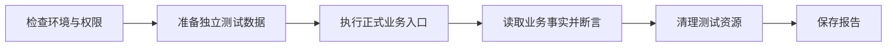

# PowerXPlugin 插件业务场景回归工作台规划

- 创建日期：2026-10-13
- 状态：本地实现与验收完成；真实 Core 授权待专用环境
- 开发分支：`025-framework-business-regression`
- 需求规格：[spec.md](../../specs/025-framework-business-regression/spec.md)
- 实施计划与任务：[plan.md](../../specs/025-framework-business-regression/plan.md)、[tasks.md](../../specs/025-framework-business-regression/tasks.md)
- 首期技术栈：Go + Nuxt
- 适用范围：PowerXPlugin Framework、Skeleton、脚手架、CLI，以及按统一规范接入的业务插件

本文定义插件业务场景回归测试的统一规范与工作台。公共测试机制由 Framework 提供，业务回归场景由各插件维护。插件开发者可以在自己的管理端发起执行、查看步骤和断言证据、查询历史并重跑失败用例。

## 1. 设计方向与已确认边界

首期采用 Go 场景 SDK 与 Nuxt 工作台，同时支持受控回归与真实集成回归。页面与 CLI 使用同一套执行机制和结果契约。

测试单位是一段有明确业务目标的场景，例如：

> 准备待支付订单 → 提交签名回调 → 验证订单状态和通知 → 重复回调 → 验证没有重复副作用。

页面重点展示“业务预期是否成立、依据是什么”。结果默认进入概览，再通过桌面左侧四分区导航查看业务校验、测试数据与清理、执行与诊断；窄屏采用可滚动导航。通过项也核对业务预期和实际，资源名称、显式来源关系和逐项清理读回均保留证据。纯函数单元测试继续使用原生测试工具，不纳入工作台的业务场景目录。

当前仓库的 `make test-regression` 主要串联 Go 测试、覆盖率与 Playwright；运行时也已有 WS Bus 等专项调试入口。新的工作台补充统一的业务场景定义、执行记录、步骤断言和证据展示，并与既有测试流程衔接。

已确认的首期边界：

1. 页面可以发起执行和查看过程，不仅用于读取测试报告。
2. 受控回归与真实集成回归均支持，分别记录实际依赖和验证结果。
3. 契约允许其他技术栈接入，先落地 Go 执行 SDK 与 Nuxt 工作台。
4. 插件以场景代码和统一 SDK 维护用例，原生 Go 测试可以调用同一场景。
5. 工作台位于各插件管理端的调试模块，不另建独立开发应用。
6. 仅在显式启用的开发或专用测试环境开放工作台。
7. 首期以 Service/API 业务场景为主，浏览器业务用例执行器不纳入本期。

## 2. Framework 与插件的职责

| 归属 | 负责内容 |
| --- | --- |
| Framework 后端 | 场景注册协议、执行器、步骤与断言 SDK、结果契约、存储接口及 Go/GORM 适配、HTTP/SSE 接口 |
| Framework 前端 | 类型化客户端、通用 Nuxt 工作台组件、状态展示、步骤详情、历史记录 |
| 各业务插件 | 场景代码、业务数据准备、真实业务调用、业务断言、测试资源清理、场景文案 |
| Skeleton／脚手架／CLI | 接入示例、迁移注册、菜单与 RBAC、统一命令和接入规范 |

公共后端模块落在 `framework/backend/go/runtime/regression`，工作台组件放入现有 Framework Admin Layer。插件提供薄页面和注册入口，避免每个插件复制执行器。

Framework 不承载订单、支付、会员等插件领域逻辑。插件负责业务场景中的依赖声明、数据准备、断言和清理，并将通用执行记录接入插件数据库。

首期不需要新增 Core 测试平台。真实集成场景使用现有 Core 接口和授权；运行记录保存在插件侧。Core 或外部系统未配置必要能力、授权或测试环境时，执行明确显示阻塞原因。

仓库现有 Framework Lab 已有分别装配 Local 与 Delegated 调试依赖的做法。工作台沿用独立依赖绑定的原则，避免在执行过程中修改应用的全局运行模式。

## 3. 统一用例规范与执行机制

### 3.1 场景定义

统一组织为：**测试套件 → 业务场景 → 执行批次 → 场景结果 → 步骤与断言**。

每个场景必须声明：

- 稳定 UUID、名称与说明的 i18n key、所属功能和标签。
- 非空步骤及非空、唯一的必要业务断言 key 列表，执行时随定义冻结并逐项核对。
- 支持的回归类型、依赖、所验证的边界，以及执行和清理超时。
- 准备、操作、断言、清理逻辑。

代码注册为用例事实来源，文档引用同一场景 UUID。场景 SDK 提供统一的注册、步骤记录、结构化断言和清理机制，页面、CLI 与原生 Go 测试复用相同的场景实现。

### 3.2 执行流程

执行流程固定为：

执行规则：

1. **受控回归**使用真实被测业务逻辑和存储，外部依赖使用显式声明的测试替身；**真实集成**使用实际 Core、授权及外部测试服务。报告逐项记录依赖实际采用的方式。
2. 两类依赖在启动时独立装配，执行绑定确定的配置，不修改应用的全局 `ProviderMode`。缺少环境或授权时显示阻塞原因，不静默回退到其他依赖或模式。
3. 场景按声明调用正式 Service 或 HTTP 入口。Service 场景只能证明服务层行为；声明验证路由、鉴权或回调的场景必须经过相应入口。
4. 断言保存结构化的预期值、实际值、证据来源、关联对象 UUID 和 Trace 信息。异步业务必须等待并读取最终事实，不能以“任务已提交”判定通过。
5. 执行状态与测试结论分开：执行结束不代表测试通过。至少声明一个必要业务断言；正常执行漏报或重复报告时失败，阻塞/跳过/证据缺失不能通过。只有所有必要断言各有一个通过结果、证据完整且清理成功，才判定通过。
6. 每次执行创建独立数据并登记资源清单；成功、失败和取消都尝试清理。清理失败保留清单，提供重新清理动作。清理仅处理本次执行登记的测试资源。
7. 首期单实例串行执行。重跑创建新记录，不覆盖历史；取消采用协作式停止，停止后再清理。
8. 进程中断的执行标记为中断，不自动重放业务操作，并保留已经持久化的结果和资源清单。

### 3.3 记录与证据

运行、场景结果和事件记录使用 UUID，并保存场景定义、输入、插件版本、源码版本及环境配置标识的快照。

结果至少能够回答：

- 本次执行验证了哪个业务场景、哪些边界，使用了什么依赖配置。
- 哪个步骤或断言失败，预期值与实际值分别是什么。
- 依据来自哪个接口、业务记录或事件，如何通过对象 UUID 与 Trace 定位。
- 测试资源是否清理完成，尚未清理的资源有哪些。

凭证不进入报告。请求、响应及其他证据在持久化和展示前按契约脱敏；不能通过解析自由文本日志替代结构化断言。

每条执行事件复用 Framework event.Meta，保留 tenant_uuid、request_id、trace_id、source_plugin、occurred_at、payload_version 六项必填字段，并严格校验、持久化；SSE 补读不改写原值。

## 4. 页面与公共接口

### 4.1 工作台视图

插件管理端在“插件能力”分组增加“业务回归”入口，位于“插件能力注册”“生命周期治理”之后，包含三个视图：

- **用例目录**：按功能、标签、回归类型筛选，查看场景步骤、依赖、验证边界和最近结果；支持单条或批量执行。
- **执行详情**：实时展示步骤、耗时、断言、预期与实际值、证据和清理结果；支持取消及重跑失败场景。
- **执行历史**：查看批次结果、环境和版本，下载标准报告。

页面显示业务名称，所有说明和错误文案走 i18n。UUID 用作内部引用、请求参数和明确的技术诊断信息，不直接替代业务名称。

管理页面的配置、按钮、字段、失败定位与验收步骤见[回归用例管理页面指南](../guides/features/025-framework-business-regression/usecase-workbench.md)。目录中的最近提示为当前配置在已加载历史中的整批结果；单场景结论以执行详情为准。插件代码维护场景定义，工作台负责执行与结果管理。

页面以“回归用例”和“执行记录”两个标签页分开任务。用例列表显示数量、业务目的、最近批次结果与行内操作；详情抽屉展示目的、步骤、通过条件和数据影响。点击运行后进入预填业务表单的准备弹窗，确认后才创建批次；批量入口仅在勾选后出现。执行后进入当次结果详情，直接显示失败差异和清理，版本／依赖／完整证据集中到技术详情。插件通过 `describeCase` 提供业务说明和表单映射，不使用 JSON 输入兜底。当前 controlled 类型包含模板创建与修改一个用例，内部有创建、修改、重新读取三个步骤。

### 4.2 接口约定

统一接口位于 `/admin/regression`，复用插件现有 API 前缀和响应封装：

| 接口 | 用途 |
| --- | --- |
| `GET /suites`、`GET /cases` | 查询场景定义及可执行条件 |
| `POST /runs` | 指定场景、依赖配置和参数，创建执行批次 |
| `GET /runs`、`GET /runs/:uuid` | 查询历史与执行快照 |
| `GET /runs/:uuid/events` | SSE 步骤和结果更新 |
| `POST /runs/:uuid/cancel`、`POST /runs/:uuid/cleanup` | 取消执行、重试清理 |
| `GET /runs/:uuid/report` | 导出标准 JSON 或 JUnit 报告 |

SSE 事件先持久化再推送，重连通过游标补读。连接异常明确显示，并提供重新连接动作，不增加隐式轮询兜底。关闭页面不取消后台执行。

接口采用独立的查看、执行和管理权限；租户与操作者来自已验证身份。执行记录、资源访问及 SSE 订阅必须按租户隔离，并沿用现有宿主会话及鉴权链路。

## 5. 首期交付与验收

### 5.1 交付顺序

1. 统一契约、规范、Go SDK、持久化适配和执行接口。
2. Framework Client 与 Nuxt 工作台，接入插件菜单、权限和 locale。
3. Skeleton 提供模板生命周期及标签绑定场景，覆盖受控与真实 Core 两类执行；同步脚手架及 CLI 内嵌模板。
4. CLI 增加 `regression list/run/report`，通过同一接口执行，`run --wait` 使用 SSE 等待结果。CI 使用相同契约。

启动装配按依赖推进：先完成受控场景的 Recorder/Runner 与模板场景，再装配 controlled profile、Service 和 worker；真实集成阶段完成 live factory 与业务场景后追加注册。

统一规范应包括场景定义与注册、测试数据准备、依赖声明、业务断言、证据采集、资源清理、页面接入、CLI 执行和报告导出，使其他插件按规范补充自己的业务场景即可接入。

### 5.2 验收场景

必须验证：

- 页面与 CLI 执行同一场景，产生一致的步骤、断言和报告。
- 业务断言失败、依赖不可用、超时、取消、进程中断、清理失败均有准确结果。
- 重复执行和幂等场景可复现；不同租户的执行、资源与 SSE 相互隔离。
- 刷新页面、断线重连后能恢复完整执行信息。
- 真实集成保留实际授权、请求和业务读回证据，与受控测试结果分别报告。
- 新生成插件按接入规范完成场景注册、执行和页面查看。

工作台自身的页面行为通过浏览器验证；Framework 源码测试、受控业务场景、真实 Core 授权与集成结果分别记录，不能互相替代。

### 5.3 实施边界

本计划首期实施范围为当前 PowerXPlugin 仓库中的公共机制及示例。其他技术栈遵循同一契约，后续增加适配；其他业务插件的具体接入以及新增 Core 能力需另行明确任务范围。

本文为设计计划，当前尚未实施代码、配置或数据库变更。

## 当前交付

Framework SDK、Store adapter、Nuxt 工作台、Skeleton 业务场景与 API、CLI 和双模板已落地。执行和证据见 [使用指南](../guides/features/025-framework-business-regression/guide.md)及 [验收记录](../../specs/025-framework-business-regression/evidence/acceptance.md)。未提交、推送或发布；正式版本升级与安装态验收另行执行。

## Template 用例扩展（2026-10-15 用户确认范围）

保留 `template.lifecycle`，新增 search、pagination、deletion、clone、partialClone、invalidInput、validation，形成 8 条可独立运行的 controlled 业务用例。输入拒绝经进程内真实 HTTP 路由验证，不宣称登录／Core 授权验收。复用现有 Runner、SSE、报告与清理协议；新增插件场景、注册、业务表单和中英文说明，同步 scaffold 与 CLI 内嵌模板。

页面支持全选当前列表；批量准备先展示业务目的和数据影响，输入按需展开，校验错误主动展开对应表单。验收覆盖正序／倒序完整批次、逐条独立执行、8 条真实浏览器整批执行、CLI 重复 `--case` 批量运行和两个生成插件。现有业务数据应保持不变，自有测试资源全部清理。后续审核发布、跨租户操作、客户／联系人场景不纳入本次实施。
